<picture>
  <source media="(prefers-color-scheme: dark)" srcset="assets/brand/banner-en-dark.png">
  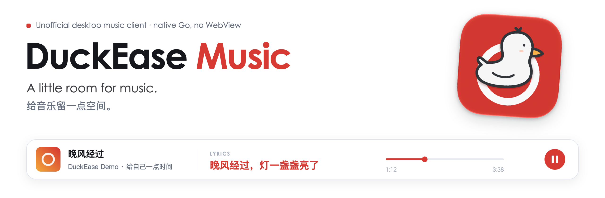
</picture>

<p>
  <a href="https://github.com/yuanruoyu515/duckease-music/releases/latest"></a>
  
  
  
  <a href="docs/MCP.md"></a>
  <a href="LICENSE"></a>
  <a href="https://www.threads.com/@realtimyry"></a>
</p>

[简体中文](README.md) · **English** · [Disclaimer / 免责声明](DISCLAIMER.md) · [Privacy / 隐私说明](PRIVACY.md)

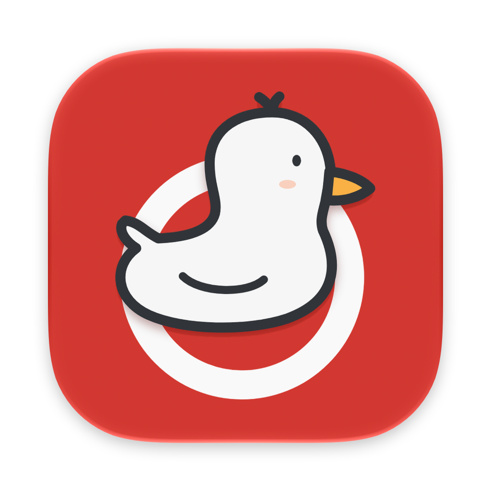

[MyGo 云音乐](https://github.com/egoist/mygo-cloudmusic) (MyGo Cloud Music) went offline. I wanted to keep using it, so I kept a copy of the source and started maintaining it for myself. This is that continuation, under the name **DuckEase Music**. Along the way it picked up things I wanted: an AI agent that can sort out my playlists, and a way to listen to my Spotify playlists through NetEase.

The original app and most of its code are the work of **egoist and the upstream contributors**. I am maintaining a derivative, with source recovered through [LeslieYon's mirror](https://github.com/LeslieYon/mygo-cloudmusic). This is an independent project; there is no claim of an official handover or endorsement.

> [!IMPORTANT]
> **Unofficial client, maintained in my spare time.** No affiliation with NetEase Cloud Music, NetEase, Spotify, or the original author. Playback still depends on your account, subscription, region, and the platform's response. Read the [disclaimer](DISCLAIMER.md) before signing in. It does not grant music rights or remove legal obligations.

<table>
  <tr>
    <td width="33%" valign="top"> <b>Native and small</b><br>MyGo draws the interface directly, with no WebView. 191 MB of memory on my Mac.</td>
    <td width="33%" valign="top"> <b>Playlists by AI agent</b><br>The app is its own MCP server. Agents such as Codex and Claude Code can read playlists, match songs in bulk, dedupe, and build new ones.</td>
    <td width="33%" valign="top"> <b>Spotify playlists, played here</b><br>Your Spotify playlists sit in the sidebar and play from NetEase matches; copy and sync playlists either way.</td>
  </tr>
</table>

## Let an AI agent manage your playlists

Tidying playlists takes hundreds of clicks, which is a job for an agent. The DuckEase Music binary carries an MCP server: `DuckEase Music mcp` opens no window and speaks MCP over stdio, using the NetEase login the app keeps in the Keychain. Sign in with the app first.

**Connecting**: click your avatar at the bottom left and choose 连接 AI Agent… (Connect AI Agent). Codex, Claude Code, Claude Desktop, and Cursor connect or disconnect in one click, or you can copy the configuration and add it yourself. For any other AI tool, click 复制给 Agent 的话 (copy a message for the agent) and paste it in; the agent sets itself up. One-click setup only adds or replaces the entry named `duckease` and saves a `.duckease-backup` beside the file first.

Then just ask, say, "remove the duplicates from these playlists" or "make a playlist from this list of songs". The tools it gets:

| For | Tools |
|---|---|
| Reading | `playlists` lists your playlists, `playlist` reads one (with an optional keyword filter), `search` searches songs |
| Finding | `match` takes up to 100 "title - artist" lines and returns the closest NetEase song and a score for each; `duplicates` finds repeated songs |
| Changing | `create_playlist`, `add_songs`, `remove_songs`, `rename_playlist`, `delete_playlist`, `like_songs` |
| Spotify | read Spotify playlists, copy either way, sync linked playlists, correct a wrong match (next section) |

Only playlists you created can be changed. Saved playlists by others are read-only, and your liked songs can't be renamed or deleted.

**Fewer tokens**: replies are tab-separated text with a header row, one song per line, much shorter than the same content in JSON. Long playlists can be read in slices, a whole list imports with a single `match` call, and playlist links or Spotify share links work as ids. Playlists that were read stay cached for a minute.

**Risk control**: the app and the MCP server are separate processes that share one pacing record. Playlist edits and searches are spaced at least 400 ms apart. After any `-460`, edits and searches pause for a while; another refusal doubles the wait, up to 15 minutes. When NetEase answers a search with 405 (too often), searching slows down for a while and then carries on. Errors returned to the agent say how long to wait so it doesn't retry early.

On the first call, the Keychain may ask whether DuckEase Music can read its login; choose Always Allow. Ad hoc signatures change with every build, so a new version may ask again. Manual setup, the full tool list, and per-call limits are in [docs/MCP.md](docs/MCP.md) (Chinese).

## Spotify and NetEase, both ways

Once Spotify is connected, the sidebar gets a Spotify 歌单 group. Open a playlist and each song is looked up on NetEase and played in DuckEase Music. **Spotify audio is not played here**: Spotify's API provides no audio, so only songs that NetEase (or the fallback source, if on) has will play. Songs without a match are listed at the bottom of the page.

**Connecting** takes a Spotify developer app of your own: create one in Spotify's Developer Dashboard with the redirect URI `http://127.0.0.1:43821/callback`, paste its Client ID under Settings → Spotify, and click 连接 (Connect). Login uses PKCE, needs no client secret, and keeps its tokens in the Keychain. Under Spotify's rules since 2026, the app's owner needs **Premium**, and only playlists **you created or collaborate on** can be read; followed and editorial playlists appear greyed out. Steps and limits are in [docs/SPOTIFY.md](docs/SPOTIFY.md) (Chinese).

**Matching** scores title, artist, and duration, and knows NetEase's artist aliases. A same-titled song by a different artist counts only if the duration matches too, so covers aren't taken for the original. The first time you open a long playlist, songs are searched one by one while a duck swims across the page; leave the page and matching carries on in the background, with a percentage beside the playlist in the sidebar. Matches are remembered, so later only new songs are searched. If a match is wrong, an agent can fix it with `fix_match`.

**Copy and sync**: a Spotify playlist page offers 复制到网易云 (copy to NetEase), and your own NetEase playlists have 复制到 Spotify in their ⋯ menu. The two playlists are then linked. Syncing can go one way or both, and it **only adds**: songs removed on one side are not removed on the other, and songs you removed since the last sync are not added back.

## A look inside

<picture>
  <source media="(prefers-color-scheme: dark)" srcset="assets/screenshots/home-dark.png">
  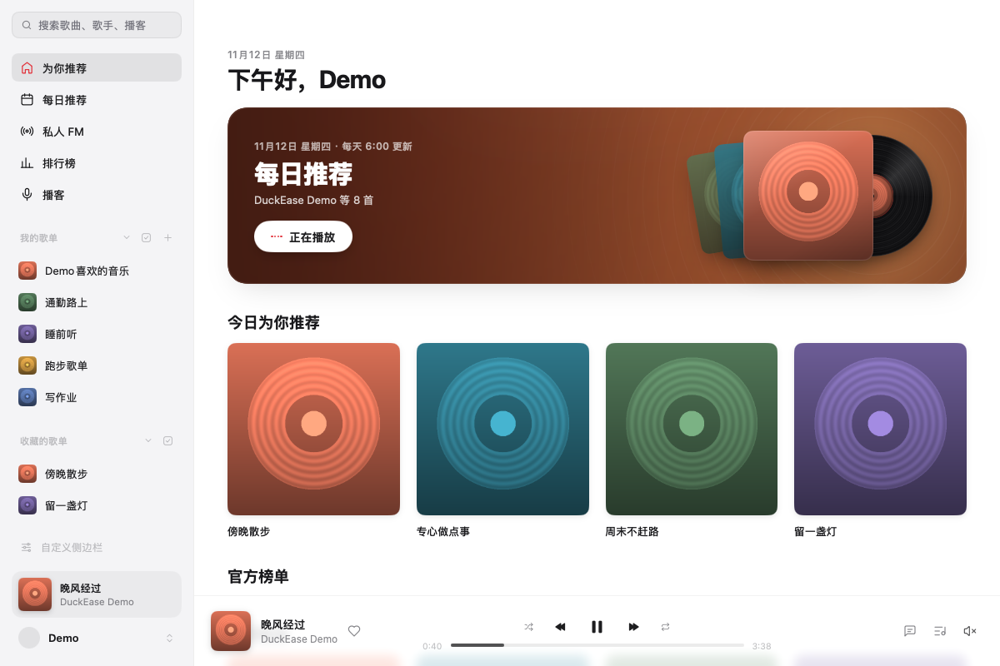
</picture>

These are offscreen renders of the app's actual Go views, using invented songs, original demo lyrics, and locally drawn artwork. They contain no personal account data and do not demonstrate live streaming or an available music catalog. [Reproduce the screenshots](docs/SCREENSHOTS.md). The interface is in Chinese.

### Now Playing

<table>
  <tr>
    <td width="50%" valign="top"><b>Now Playing</b><br>Cover, controls, and scrolling lyrics with translations on one page; tilt the cover with the pointer, or fling it to change songs. A song from the fallback source is marked under the progress bar with the quality it served.<br><br><picture><source media="(prefers-color-scheme: dark)" srcset="assets/screenshots/now-playing-dark.png">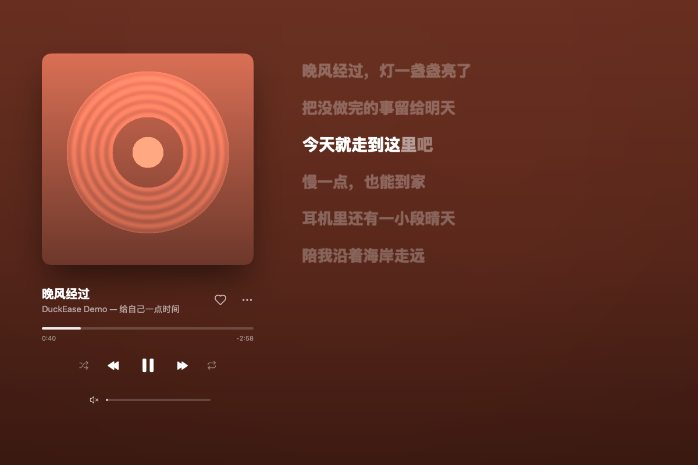</picture></td>
    <td width="50%" valign="top"><b>Fog backdrop</b><br>An experiment: the backdrop turns into fog in the cover's colors that swells with the bass. Turn it on under Settings → 实验性功能.<br><br><picture><source media="(prefers-color-scheme: dark)" srcset="assets/screenshots/fog-dark.png">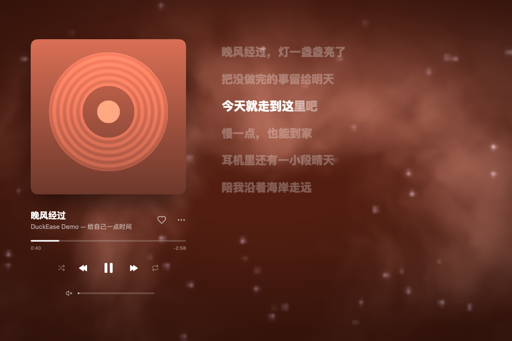</picture></td>
  </tr>
</table>

The lyric stage sets the current line on its own, following each word as it is sung, in three styles:

<table>
  <tr>
    <td width="33%" valign="top"><b>流光</b><br>Words light up one by one, line after line.<br><br><picture><source media="(prefers-color-scheme: dark)" srcset="assets/screenshots/stage-dark.png">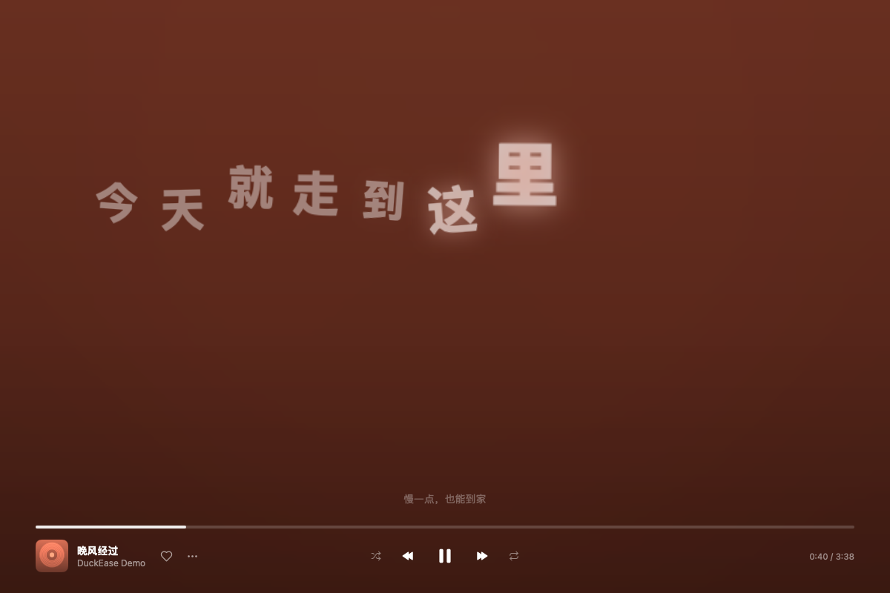</picture></td>
    <td width="33%" valign="top"><b>云阶</b><br>Words step up and down a stair, the one sung glowing.<br><br><picture><source media="(prefers-color-scheme: dark)" srcset="assets/screenshots/stage-partita-dark.png">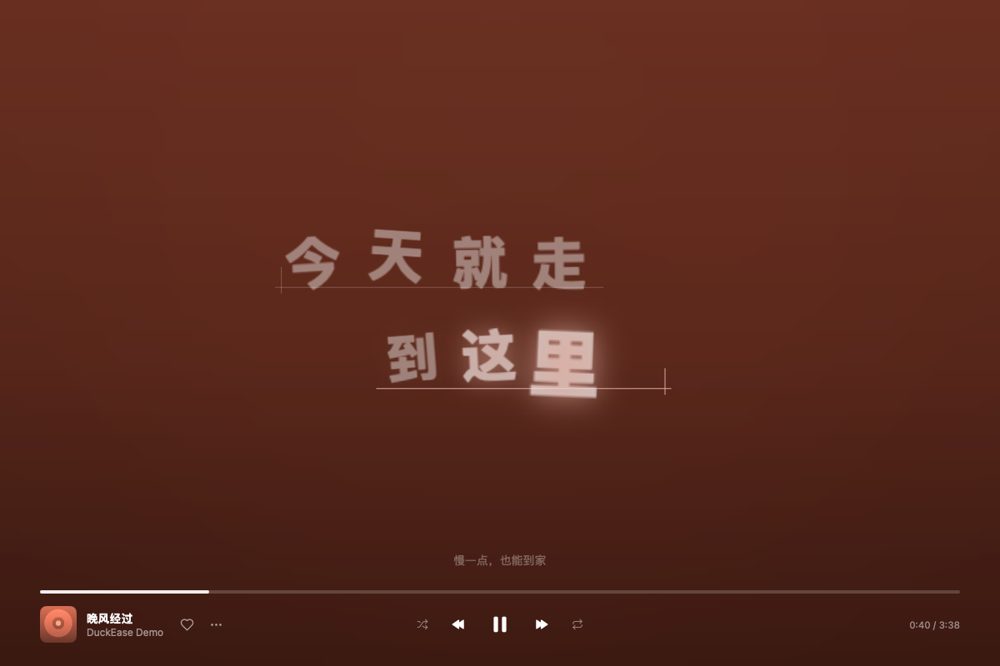</picture></td>
    <td width="33%" valign="top"><b>倾诉</b><br>Large, centered, one line after another.<br><br><picture><source media="(prefers-color-scheme: dark)" srcset="assets/screenshots/stage-tilt-dark.png"></picture></td>
  </tr>
</table>

<table>
  <tr>
    <td width="50%" valign="top"><b>Pick a song</b><br>The queue laid out as a row of covers: drag through it, click one to play it.<br><br><picture><source media="(prefers-color-scheme: dark)" srcset="assets/screenshots/wall-dark.png">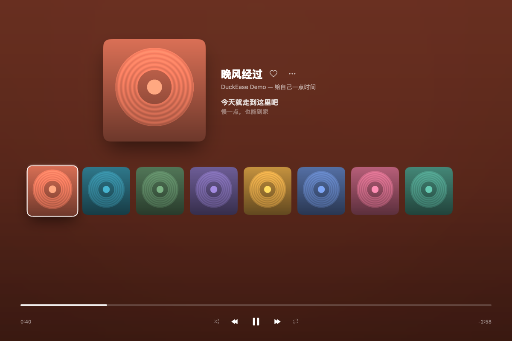</picture></td>
    <td width="50%" valign="top"><b>Queue</b><br>What plays next; click a song to jump to it.<br><br><picture><source media="(prefers-color-scheme: dark)" srcset="assets/screenshots/queue-dark.png">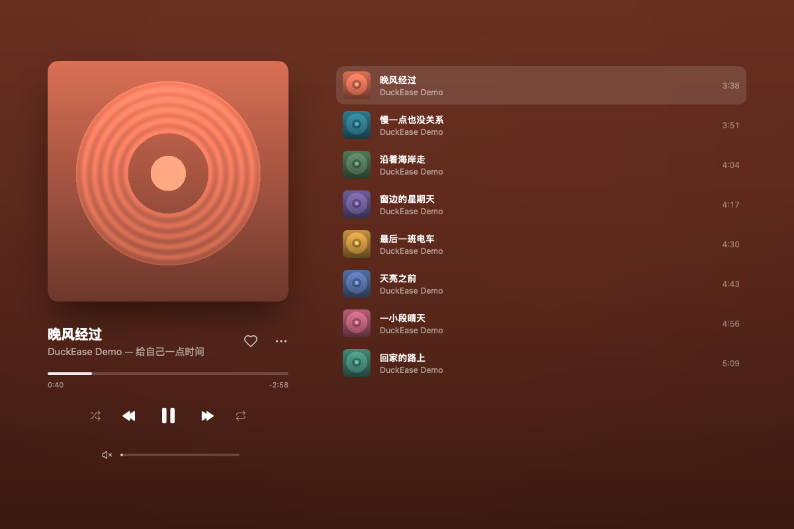</picture></td>
  </tr>
</table>

### Songs and playlists

<table>
  <tr>
    <td width="50%" valign="top"><b>Daily recommendations</b><br>Renewed at 6:00 Beijing time, even if the window stays open overnight.<br><br><picture><source media="(prefers-color-scheme: dark)" srcset="assets/screenshots/daily-dark.png">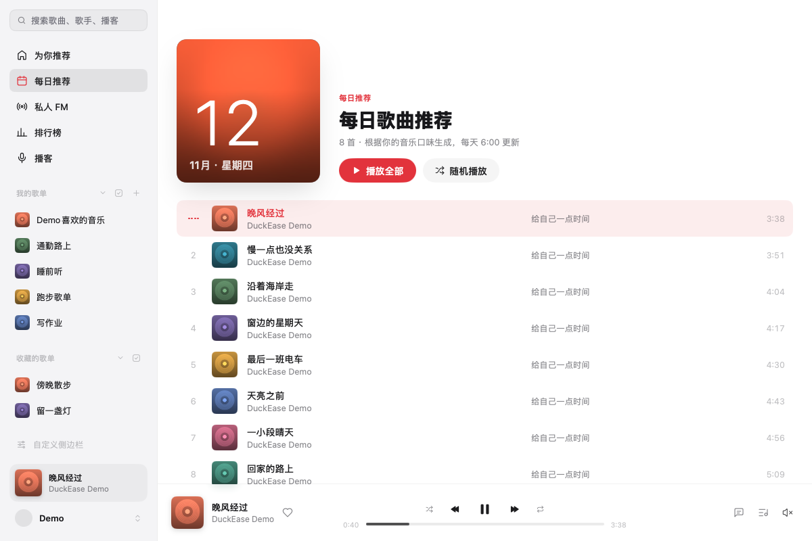</picture></td>
    <td width="50%" valign="top"><b>Sort, search, Feeling lucky</b><br>Sort a playlist by name, artist, album, or length, Chinese by pinyin; Feeling lucky shuffles it anew each time. Search within the playlist, or the whole catalog when it isn't there.<br><br><picture><source media="(prefers-color-scheme: dark)" srcset="assets/screenshots/playlist-dark.png">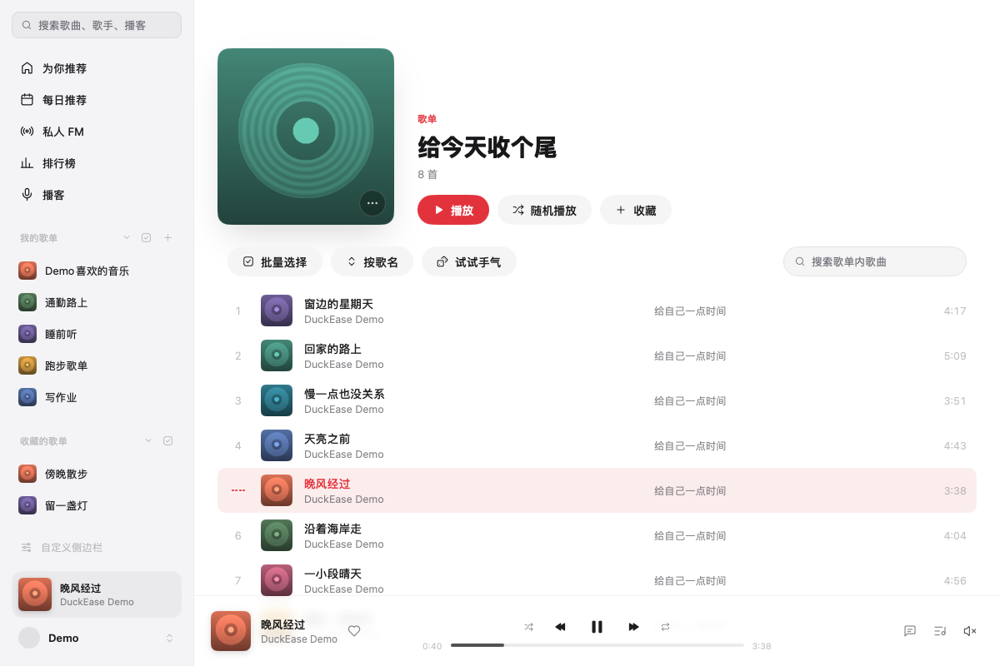</picture></td>
  </tr>
  <tr>
    <td width="50%" valign="top"><b>Pick songs</b><br>Click to pick, Shift-click for a range, ⌘A for all. A floating bar adds them to a playlist, moves them to another, or removes them. Liked songs can be unliked this way too.<br><br><picture><source media="(prefers-color-scheme: dark)" srcset="assets/screenshots/picking-dark.png">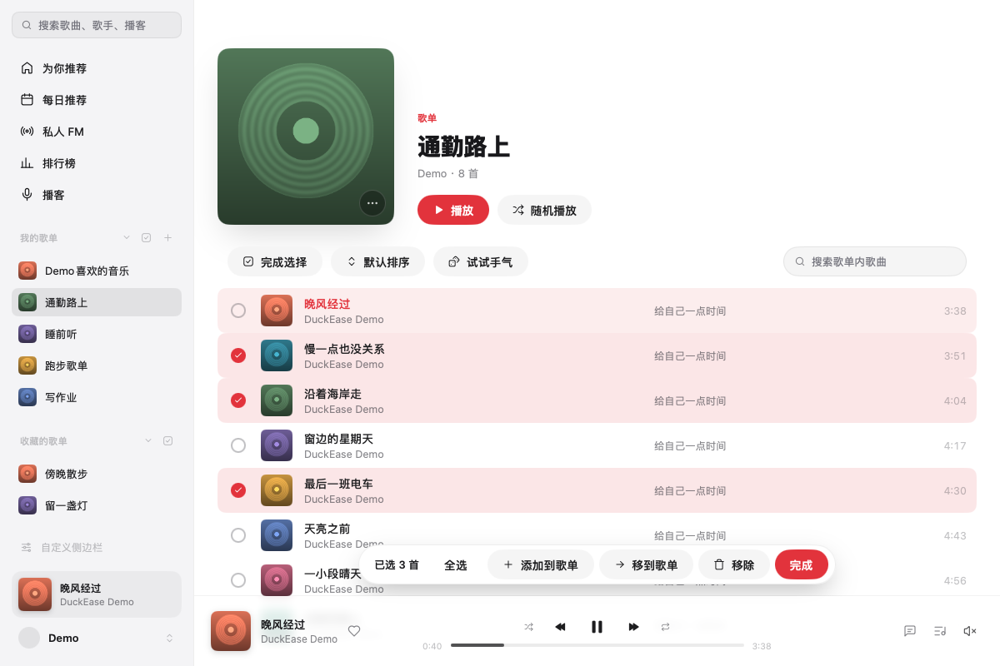</picture></td>
    <td width="50%" valign="top"><b>Playlist manager</b><br>Copy or migrate several of your playlists into one, or delete them together; copy saved playlists as your own, merge them, or unsave them. Requests go one at a time to stay clear of NetEase's risk control.<br><br><picture><source media="(prefers-color-scheme: dark)" srcset="assets/screenshots/manager-dark.png">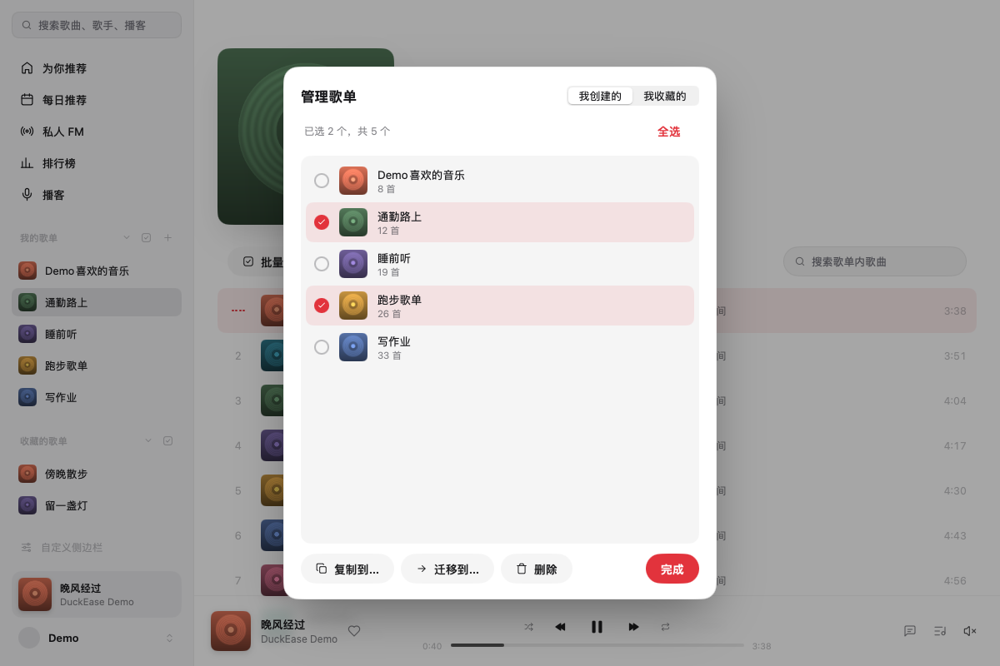</picture></td>
  </tr>
  <tr>
    <td width="50%" valign="top"><b>Covers</b><br>Choose 更换封面 from the ⋯ on a cover's corner: search the album covers of its songs, or pick a picture from disk. It stays on this Mac.<br><br><picture><source media="(prefers-color-scheme: dark)" srcset="assets/screenshots/cover-picker-dark.png">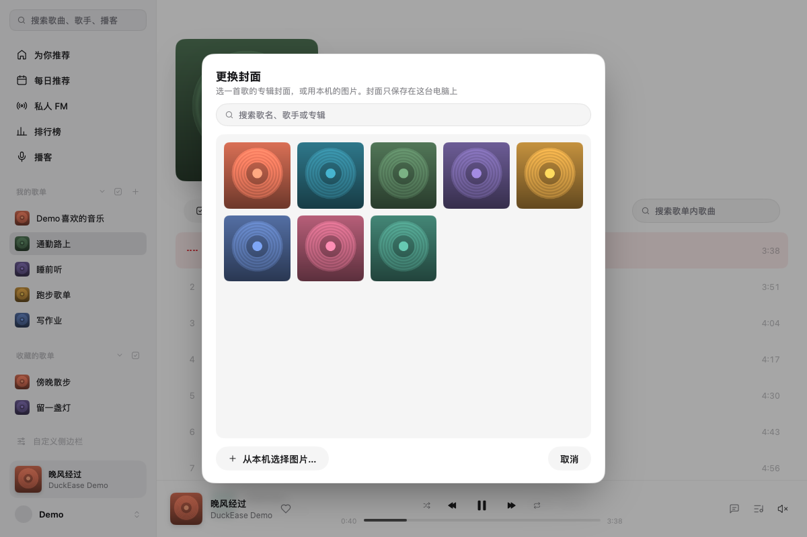</picture></td>
    <td width="50%" valign="top"><b>Your sidebar</b><br>Turn each section on or off, reorder them by drag or arrows, and hide the Now Playing card.<br><br><picture><source media="(prefers-color-scheme: dark)" srcset="assets/screenshots/sidebar-dark.png">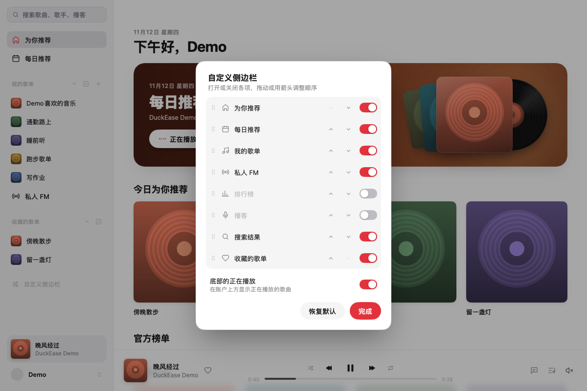</picture></td>
  </tr>
</table>

### Settings

<table>
  <tr>
    <td width="50%" valign="top"><b>Fallback source and its quota</b><br>Off by default. When on, songs NetEase won't stream and greyed-out songs come from GD音乐台, and a bar under the switch shows how much of its 40 requests per five minutes is used.<br><br><picture><source media="(prefers-color-scheme: dark)" srcset="assets/screenshots/settings-dark.png">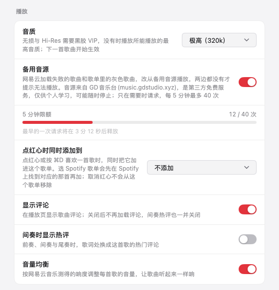</picture></td>
    <td width="50%" valign="top"><b>iCloud backup</b><br>Save the app's settings, sidebar layout, search history and covers to iCloud Drive by hand, and restore them on another Mac. Nothing of your NetEase account is included.<br><br><picture><source media="(prefers-color-scheme: dark)" srcset="assets/screenshots/backup-dark.png">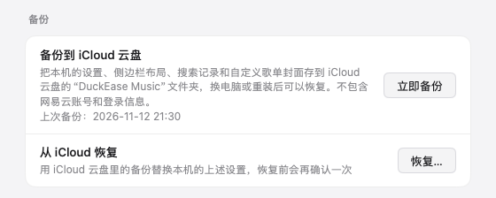</picture></td>
  </tr>
</table>

### And also

- **Hot comments between verses**: in intros, breaks and outros, the song's hot comments take the lyrics' place.
- **Heartbeat mode and Personal FM**: start Heartbeat mode from your liked songs, and it keeps recommending.
- **Podcasts**: listen, subscribe, and like episodes.
- **Volume normalization** by the loudness NetEase measured for each song.
- **Next song preloaded**: ten seconds into a song, the next one starts downloading, so skipping ahead plays almost at once.
- **Song cache**: songs you played stay on disk and start at once, up to a limit you choose; playback resumes where you left it.
- **Smoke progress bar**: an experiment that turns the bar into a comet trailing smoke.
- **Keyboard**: Space plays and pauses, ⌘F searches, ⌘[ and ⌘] go back and forward, ⌘D likes, ⌘1–5 switch Now Playing's tabs.
- **Stops on risk control**: on `-460` the player cools down for 30 seconds instead of skipping through the playlist.
- **Update check** against this repository's releases only; it offers a download and never installs anything itself.

## 191 MB on my Mac

A native Go app with no WebView. This is my own local memory snapshot: **191 MB** for DuckEase Music.

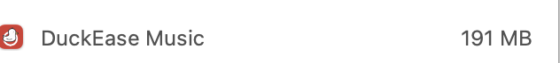

One snapshot, not a fixed memory budget or a controlled benchmark. Usage changes with playback, artwork, cache, and open views.

## What it does

| Listening | Browsing | On your desktop |
|---|---|---|
| Queue, shuffle, repeat, likes | Daily recommendations, playlists, charts | Light, dark, or system appearance |
| Standard through Hi-Res quality, when available | Songs, artists, albums, users, podcasts | Local audio cache, playback resume, next song preloaded |
| Synced lyrics and translations | Personal FM and Heartbeat mode | Cover gestures and keyboard controls |
| Podcast playback and subscriptions | Artist, album, and user pages | Customizable sidebar |
| Pick, move, and remove songs in bulk | Playlist manager, copy saved playlists | Custom playlist covers, iCloud backup |
| Spotify playlists played through NetEase matches | Copy and sync playlists between Spotify and NetEase | Built-in MCP server for AI agents |

Availability comes from the platform. Selecting a quality does not create an entitlement to it. This project does not add subscription unlocking or a promise to bypass access restrictions. The one exception is opt-in and off by default: the **Fallback source** setting asks the third-party [GD音乐台](https://music.gdstudio.xyz) API for songs that fail to load or show greyed out. That service is free, run by someone else, for personal study only, and may stop at any time.

## What changed from MyGo 云音乐

- Renamed the app to **DuckEase Music**, with a duck icon and migration of older local data folders.
- Added an MCP server and 连接 AI Agent…, so agents can read and edit your own NetEase playlists; added matched playback, copying, and syncing of Spotify playlists.
- Smoother playback: the next song downloads ahead of time, failed streams get bounded retries and diagnostic logging, and on risk-control code `-460` the player stops and cools down instead of skipping through the queue.
- Easier playlists: sorting and search, picking songs in bulk, a playlist manager, and custom covers.
- Also a customizable sidebar, an optional fallback source, a switch for comments, and iCloud backup; the notch player is gone.
- Replaced the old automatic updater, which depended on the original author's releases, with a check of this repository's releases that only prompts you to download.
- Removed local podcast transcription, which depended on unavailable speech-library downloads. Podcast listening remains.
- Removed the inherited website, its music demo, and the original author's release/signing workflow from this publication.

See [provenance and modification dates](NOTICE.md), what's new in each [release](https://github.com/yuanruoyu515/duckease-music/releases) and the [changelog](CHANGELOG.md), and [maintenance notes](MAINTENANCE.md). This repository starts from a clean publication snapshot; older local development history is not uploaded with it.

## Install on macOS

[**Download the latest macOS DMG**](https://github.com/yuanruoyu515/duckease-music/releases/latest): get the `.dmg` from the release page, which also lists what's new and the checksums.

1. Download and open the DMG.
2. Drag **DuckEase Music** onto **Applications** beside it.
3. Eject the disk image, then open DuckEase Music from Applications.

Requires macOS **13+**. The universal app contains Apple Silicon and Intel code; local build and packaging checks ran on Apple Silicon, with no Intel runtime verification. This release is **ad hoc signed and not Apple notarized**. If macOS blocks it, verify the download and its checksum, then approve it in Privacy & Security following [Apple's instructions for an unidentified developer](https://support.apple.com/en-us/102445). Keep system-wide security protections enabled.

The app checks this repository's releases at launch and once a day. When a newer version is out, it offers to download the DMG, remind you later, or skip that version. It never installs anything by itself, and you can turn the check off in Settings → Updates. The matching source is available under the release tag; license and source information are also bundled in the app.

## Build it

| Requirement | Notes |
|---|---|
| Go **1.27.4 or newer** | The version required by `go.mod` |
| macOS **13+**, for the Mac app | This fork's local build and packaging have been checked on Apple Silicon |
| Xcode, for macOS packaging | Includes `actool`, needed for the app icon; Command Line Tools alone are insufficient |
| Network access | Required to fetch dependencies and use the platform's services |

```bash
git clone https://github.com/yuanruoyu515/duckease-music.git
cd duckease-music

# Run the native app in development mode.
go tool mygo dev

# Test, then package an ad hoc signed macOS app and disk image.
./scripts/build-local.sh
```

The Apple Silicon output is in `build/darwin-arm64/`: `DuckEase Music.app` and a `.dmg`. To request a universal Mac build, use `./scripts/build-local.sh -platform darwin/universal`; Intel execution has not been verified for this fork. The inherited Windows and Linux paths are also unverified.

Local builds have **ad hoc signatures and no Apple notarization**. They do not use the original author's Developer ID. macOS may require approval in Privacy & Security before opening a downloaded build; do not disable system-wide security protections.

> [!NOTE]
> **Moving from the original app:** quit it first. The legacy bundle identifier is retained for local login compatibility, so both apps cannot run independently at the same time. The first launch may move an older app's settings and cache into DuckEase's folders. Back them up if you need to keep both. A changed signature can prompt Keychain approval or require a new QR login.

## Before signing in

- Use an account you are comfortable using with an unofficial client. Login, playback, and availability may change or stop without notice.
- The packaged app stores login credentials through the system credential store. Development builds keep a session file on disk. Neither belongs in an issue or a Git commit.
- The app contacts NetEase services and media hosts, and Spotify only if you connect it. There is no maintainer-operated music proxy or account service in this code. The maintainer does not control the platform's data handling.
- An agent connected over MCP uses your NetEase login and can change or delete your own playlists. Check what it plans to do before it does it.
- Cache, settings, listening state, song matches, and diagnostic logs remain on your device. Logs can contain track identifiers and error details; review them before sharing.

Read the full [privacy notes](PRIVACY.md) and [disclaimer](DISCLAIMER.md) for the account, content, and support boundaries.

## Contributing and reporting problems

Personal maintenance has no release schedule or response-time commitment. Small, reproducible fixes are welcome. Follow [CONTRIBUTING.md](CONTRIBUTING.md) and the [test rules](AGENTS.md).

For playback trouble, include your OS, commit, what you clicked, and a redacted error. A `-460` response is a reason to wait, not to increase retries. Please do not request VIP unlocking, region-lock bypasses, bulk scraping, or credential sharing.

Rights holders can open a [rights report](https://github.com/yuanruoyu515/duckease-music/issues/new?template=rights.yml) identifying the material and requested action. Please do not post personal documents or private correspondence publicly. GitHub also provides its own [copyright process](https://docs.github.com/en/site-policy/content-removal-policies/guide-to-submitting-a-dmca-takedown-notice).

## Credits and license

- **[egoist](https://github.com/egoist) and upstream contributors** — the original [MyGo 云音乐](https://github.com/egoist/mygo-cloudmusic) app and the foundation of this fork. Their later [MyGo Music](https://github.com/egoist/mygo-music) is a separate player built from the same code.
- **[LeslieYon/mygo-cloudmusic](https://github.com/LeslieYon/mygo-cloudmusic)** — the preserved source used here, at `3c0eb71`.
- **[MyGo](https://github.com/egoist/mygo)** — native application and UI framework.
- **[NeteaseCloudMusicApi](https://github.com/Binaryify/NeteaseCloudMusicApi)** — a reference for encryption and login flows.
- **[folia-major](https://github.com/chthollyphile/folia-major)** — a reference for lyric animation.
- **[GD音乐台(music.gdstudio.xyz)](https://music.gdstudio.xyz)** — the optional fallback source, an API by GD Studio, credited as the site asks.

Source code continues under **[AGPL-3.0](LICENSE)**. Keep upstream attribution and license notices; redistribution and modified network deployments must follow the applicable license requirements. The software license does not grant rights to music, lyrics, artwork, or third-party trademarks. See [NOTICE.md](NOTICE.md).

Maintained by **Ruoyu / SysNomad** · [GitHub](https://github.com/yuanruoyu515) · [Threads @realtimyry](https://www.threads.com/@realtimyry)
