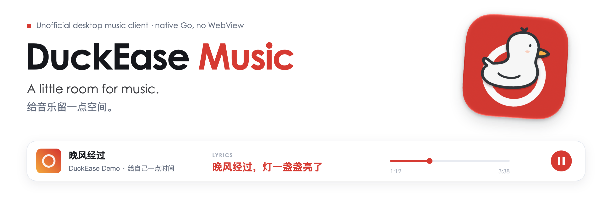

<picture>
  <source media="(prefers-color-scheme: dark)" srcset="assets/brand/banner-en-dark.png">
  
</picture>

<p>
  <a href="https://github.com/yuanruoyu515/duckease-music/releases/latest"></a>
  
  
  
  <a href="LICENSE"></a>
  <a href="https://www.threads.com/@realtimyry"></a>
</p>

**English** · [简体中文](README.zh-CN.md) · [Disclaimer / 免责声明](DISCLAIMER.md) · [Privacy / 隐私说明](PRIVACY.md)


[MyGo 云音乐](https://github.com/egoist/mygo-cloudmusic) (MyGo Cloud Music) went offline. I wanted to keep using it, so I kept a copy of the source and started maintaining it for myself. This is that continuation, under the name **DuckEase Music**.

The original app and most of its code are the work of **egoist and the upstream contributors**. I am maintaining a derivative, with source recovered through [LeslieYon's mirror](https://github.com/LeslieYon/mygo-cloudmusic). This is an independent project; there is no claim of an official handover or endorsement.

> [!IMPORTANT]
> **Unofficial client, maintained in my spare time.** No affiliation with NetEase Cloud Music, NetEase, or the original author. Playback still depends on your account, subscription, region, and the platform's response. Read the [disclaimer](DISCLAIMER.md) before signing in. It does not grant music rights or remove legal obligations.

<table>
  <tr>
    <td width="33%" valign="top"> <b>Native, in Go</b><br>MyGo renders the interface directly. No WebView in the desktop app.</td>
    <td width="33%" valign="top"> <b>Room for the lyrics</b><br>A full playback view, translated lyrics, and animated lyric styles.</td>
    <td width="33%" valign="top"> <b>Personal maintenance</b><br>A separate name, a duck icon, and fixes for the version I use.</td>
  </tr>
</table>

## A look inside

<picture>
  <source media="(prefers-color-scheme: dark)" srcset="assets/screenshots/home-dark.png">
  
</picture>

These are renders of the app's actual Go views, using invented songs, original demo lyrics, and locally drawn artwork. They contain no personal account data and do not demonstrate live streaming or an available music catalog. [Reproduce the screenshots](docs/SCREENSHOTS.md).

<table>
  <tr>
    <td width="50%" valign="top"><b>Now Playing</b><br>Cover art, playback controls, and a scrollable lyric view. A song from the fallback source is marked under the progress bar.<br><br><picture><source media="(prefers-color-scheme: dark)" srcset="assets/screenshots/now-playing-dark.png"></picture></td>
    <td width="50%" valign="top"><b>Lyric stage</b><br>A separate view for the animated lyric styles.<br><br><picture><source media="(prefers-color-scheme: dark)" srcset="assets/screenshots/stage-dark.png"></picture></td>
  </tr>
</table>

## New in 0.1.25-duckease.5

<table>
  <tr>
    <td width="50%" valign="top"><b>Pick songs</b><br>Press 批量选择 on a playlist page, then click songs to pick them, Shift-click for a range, ⌘A for all. A floating bar adds them to a playlist, moves them to another, or removes them. Liked songs can be unliked this way too.<br><br><picture><source media="(prefers-color-scheme: dark)" srcset="assets/screenshots/picking-dark.png"></picture></td>
    <td width="50%" valign="top"><b>Playlist manager</b><br>From the buttons beside the sidebar's playlist headers. Copy or migrate several of your playlists into one, or delete them together; copy saved playlists as your own, merge them, or unsave them. Requests go one at a time to stay clear of NetEase's risk control.<br><br><picture><source media="(prefers-color-scheme: dark)" srcset="assets/screenshots/manager-dark.png"></picture></td>
  </tr>
  <tr>
    <td width="50%" valign="top"><b>Covers</b><br>Open ⋯ on the corner of your own playlist's cover and choose 更换封面: search the album covers of its songs, or pick a picture from disk. The cover stays on this Mac.<br><br><picture><source media="(prefers-color-scheme: dark)" srcset="assets/screenshots/cover-picker-dark.png"></picture></td>
    <td width="50%" valign="top"><b>Your sidebar</b><br>自定义侧边栏 at the end of the sidebar turns each section on or off and reorders them by drag or arrows. The Now Playing card can be hidden too.<br><br><picture><source media="(prefers-color-scheme: dark)" srcset="assets/screenshots/sidebar-dark.png"></picture></td>
  </tr>
  <tr>
    <td width="50%" valign="top"><b>Fallback source, visible</b><br>Songs from the fallback source carry a 备用音源 badge and the quality it served on Now Playing. With the fallback on, Settings shows how much of its 40 requests per five minutes is used.<br><br><picture><source media="(prefers-color-scheme: dark)" srcset="assets/screenshots/settings-dark.png"></picture></td>
    <td width="50%" valign="top"><b>iCloud backup</b><br>Settings → Backup saves the app's settings, sidebar layout, search history and covers to iCloud Drive, by hand, and restores them on another Mac. Nothing of your NetEase account is included.<br><br><picture><source media="(prefers-color-scheme: dark)" srcset="assets/screenshots/backup-dark.png"></picture></td>
  </tr>
</table>

The notch player is gone, and the ⋯ button now sits on the playlist cover's corner.

## 191 MB on my Mac

A native Go app with no WebView. This is my own local memory snapshot: **191 MB** for DuckEase Music.


One snapshot, not a fixed memory budget or a controlled benchmark. Usage changes with playback, artwork, cache, and open views.

## What it does

| Listening | Browsing | On your desktop |
|---|---|---|
| Queue, shuffle, repeat, likes | Daily recommendations, playlists, charts | Light, dark, or system appearance |
| Standard through Hi-Res quality, when available | Songs, artists, albums, users, podcasts | Local audio cache and playback resume |
| Synced lyrics and translations | Personal FM and Heartbeat mode | Cover gestures and keyboard controls |
| Podcast playback and subscriptions | Artist, album, and user pages | Customizable sidebar |
| Pick, move, and remove songs in bulk | Playlist manager, copy saved playlists | Custom playlist covers, iCloud backup |

Availability comes from the platform. Selecting a quality does not create an entitlement to it. This project does not add subscription unlocking or a promise to bypass access restrictions. The one exception is opt-in and off by default: the **Fallback source** setting asks the third-party [GD音乐台](https://music.gdstudio.xyz) API for songs that fail to load or show greyed out. That service is free, run by someone else, for personal study only, and may stop at any time.

## What changed from MyGo 云音乐

- Renamed the app to **DuckEase Music**, with a duck icon and migration of older local data folders.
- Replaced the old automatic updater, which depended on the original author's releases, with a check of this repository's releases that only prompts you to download.
- Removed local podcast transcription, which depended on unavailable speech-library downloads. Podcast listening remains.
- Added bounded playback retries and diagnostic logging. When the platform returns risk-control code `-460`, the player stops and cools down instead of skipping through the queue.
- Removed the inherited website, its music demo, and the original author's release/signing workflow from this publication.
- Added playlist sorting, Feeling lucky, and playlist search; an optional fallback source; and a switch for comments.
- Added picking songs in bulk, a playlist manager, custom playlist covers, a customizable sidebar and iCloud backup; removed the notch player.

See [provenance and modification dates](NOTICE.md), [changes](CHANGELOG.md), and [maintenance notes](MAINTENANCE.md). This repository starts from a clean publication snapshot; older local development history is not uploaded with it.

## Install on macOS

[**Download the macOS DMG**](https://github.com/yuanruoyu515/duckease-music/releases/download/v0.1.25-duckease.5/duckease-music-0.1.25-duckease.5.dmg) · [Release notes and checksums](https://github.com/yuanruoyu515/duckease-music/releases/tag/v0.1.25-duckease.5)

1. Download and open the DMG.
2. Drag **DuckEase Music** onto **Applications** beside it.
3. Eject the disk image, then open DuckEase Music from Applications.

Requires macOS **13+**. The universal app contains Apple Silicon and Intel code; local build and packaging checks ran on Apple Silicon, with no Intel runtime verification. This release is **ad hoc signed and not Apple notarized**. If macOS blocks it, follow [Apple's instructions for an unidentified developer](https://support.apple.com/en-us/102445), after verifying the download and its checksum. Keep system-wide security protections enabled.

The app checks this repository's releases at launch and once a day. When a newer version is out, it offers to download the DMG, remind you later, or skip that version. It never installs anything by itself, and you can turn the check off in Settings → Updates. The matching source is available under the release tag; license and source information are also bundled in the app.

## Build it

| Requirement | Notes |
|---|---|
| Go **1.27.3 or newer** | The version required by `go.mod` |
| macOS **13+**, for the Mac app | This fork's local build and packaging have been checked on Apple Silicon |
| Xcode, for macOS packaging | Includes `actool`, needed for the app icon; Command Line Tools alone are insufficient |
| Network access | Required to fetch dependencies and use the platform's services |

```bash
git clone https://github.com/yuanruoyu515/duckease-music.git
cd duckease-music

# Run the native app in development mode.
go tool mygo dev

# Test, then package an ad hoc signed macOS app and disk image.
./scripts/build-local.sh
```

The Apple Silicon output is in `build/darwin-arm64/`: `DuckEase Music.app` and a `.dmg`. To request a universal Mac build, use `./scripts/build-local.sh -platform darwin/universal`; Intel execution has not been verified for this fork. The inherited Windows and Linux paths are also unverified.

Local builds have **ad hoc signatures and no Apple notarization**. They do not use the original author's Developer ID. macOS may require approval in Privacy & Security before opening a downloaded build; do not disable system-wide security protections.

> [!NOTE]
> **Moving from the original app:** quit it first. The legacy bundle identifier is retained for local login compatibility, so both apps cannot run independently at the same time. The first launch may move an older app's settings and cache into DuckEase's folders. Back them up if you need to keep both. A changed signature can prompt Keychain approval or require a new QR login.

## Before signing in

- Use an account you are comfortable using with an unofficial client. Login, playback, and availability may change or stop without notice.
- The packaged app stores login credentials through the system credential store. Development builds keep a session file on disk. Neither belongs in an issue or a Git commit.
- The app contacts NetEase services and media hosts. There is no maintainer-operated music proxy or account service in this code. The maintainer does not control the platform's data handling.
- Cache, settings, listening state, and diagnostic logs remain on your device. Logs can contain track identifiers and error details; review them before sharing.

Read the full [privacy notes](PRIVACY.md) and [disclaimer](DISCLAIMER.md) for the account, content, and support boundaries.

## Contributing and reporting problems

Personal maintenance has no release schedule or response-time commitment. Small, reproducible fixes are welcome. Follow [CONTRIBUTING.md](CONTRIBUTING.md) and the [test rules](AGENTS.md).

For playback trouble, include your OS, commit, what you clicked, and a redacted error. A `-460` response is a reason to wait, not to increase retries. Please do not request VIP unlocking, region-lock bypasses, bulk scraping, or credential sharing.

Rights holders can open a [rights report](https://github.com/yuanruoyu515/duckease-music/issues/new?template=rights.yml) identifying the material and requested action. Please do not post personal documents or private correspondence publicly. GitHub also provides its own [copyright process](https://docs.github.com/en/site-policy/content-removal-policies/guide-to-submitting-a-dmca-takedown-notice).

## Credits and license

- **[egoist](https://github.com/egoist) and upstream contributors** — the original [MyGo 云音乐](https://github.com/egoist/mygo-cloudmusic) app and the foundation of this fork. Their later [MyGo Music](https://github.com/egoist/mygo-music) is a separate player built from the same code.
- **[LeslieYon/mygo-cloudmusic](https://github.com/LeslieYon/mygo-cloudmusic)** — the preserved source used here, at `3c0eb71`.
- **[MyGo](https://github.com/egoist/mygo)** — native application and UI framework.
- **[NeteaseCloudMusicApi](https://github.com/Binaryify/NeteaseCloudMusicApi)** — a reference for encryption and login flows.
- **[folia-major](https://github.com/chthollyphile/folia-major)** — a reference for lyric animation.
- **[GD音乐台(music.gdstudio.xyz)](https://music.gdstudio.xyz)** — the optional fallback source, an API by GD Studio, credited as the site asks.

Source code continues under **[AGPL-3.0](LICENSE)**. Keep upstream attribution and license notices; redistribution and modified network deployments must follow the applicable license requirements. The software license does not grant rights to music, lyrics, artwork, or third-party trademarks. See [NOTICE.md](NOTICE.md).

Maintained by **Ruoyu / SysNomad** · [GitHub](https://github.com/yuanruoyu515) · [Threads @realtimyry](https://www.threads.com/@realtimyry)
