<picture>
  <source media="(prefers-color-scheme: dark)" srcset="assets/brand/banner-zh-Hans-dark.png">
  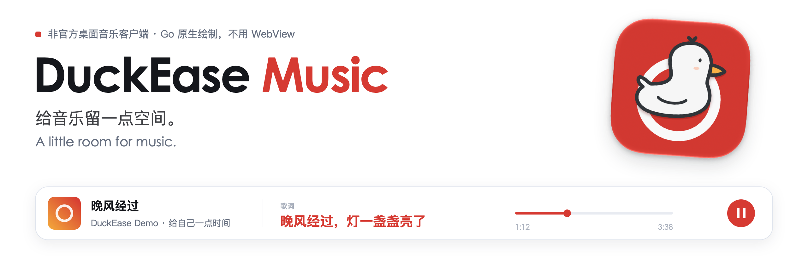
</picture>

<p>
  <a href="https://github.com/yuanruoyu515/duckease-music/releases/latest"></a>
  
  
  
  <a href="docs/MCP.md"></a>
  <a href="LICENSE"></a>
  <a href="https://www.threads.com/@realtimyry"></a>
</p>

**简体中文** · [English](README.en.md) · [免责声明](DISCLAIMER.md) · [隐私说明](PRIVACY.md)

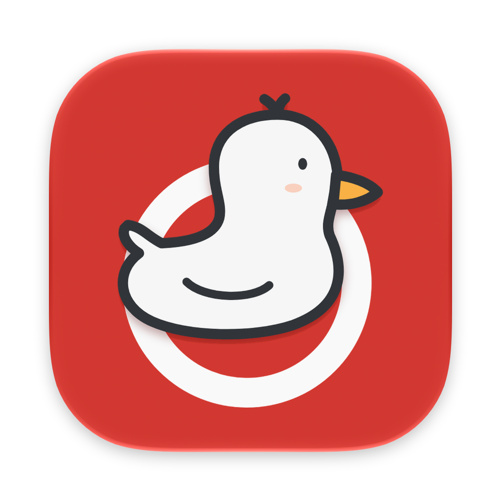

[MyGo Music（MyGo 云音乐）](https://github.com/egoist/mygo-cloudmusic)下线了。我还想继续用，就保留了一份源码，接着修自己碰到的问题。这个仓库是它的个人接续维护版，现在叫 **DuckEase Music**。修着修着也加了些自己想要的：让 AI agent 帮我理歌单，把 Spotify 上的歌单拿到网易云来听。

原应用和大部分代码由 **egoist 及原项目贡献者**完成。我通过 [LeslieYon 保留的镜像](https://github.com/LeslieYon/mygo-cloudmusic)取得源码，在此基础上维护衍生版本。这里的「接续维护」是我自己的行为，不代表原作者正式移交、授权代理或背书。

> [!IMPORTANT]
> **非官方客户端，业余维护。** 与网易、网易云音乐、Spotify 及原作者没有隶属、合作或代言关系。能否播放仍取决于账号、会员、地区和平台返回结果。登录前请读[免责声明](DISCLAIMER.md)；声明不能授予音乐版权，也不能免除法定义务。

<table>
  <tr>
    <td width="33%" valign="top"> <b>原生，占得少</b><br>MyGo 直接绘制界面，不套 WebView。在我的 Mac 上占 191 MB 内存。</td>
    <td width="33%" valign="top"> <b>让 AI agent 理歌单</b><br>应用本身就是 MCP 服务器。Codex、Claude Code 这类 agent 能读歌单、批量找歌、去重、建歌单。</td>
    <td width="33%" valign="top"> <b>Spotify 歌单拿来听</b><br>Spotify 歌单显示在侧边栏，歌从网易云找来播放；两边歌单能互相复制、同步。</td>
  </tr>
</table>

## 让 AI agent 管歌单

整理歌单这种活，点几百下鼠标很烦，交给 agent 正合适。DuckEase Music 的程序本身带一个 MCP 服务器：`DuckEase Music mcp` 不开窗口，只在标准输入输出上跟 agent 说话，用的是 app 存在钥匙串里的网易云登录。所以先在 app 里扫码登录。

**接上它**：点左下角头像，选「连接 AI Agent…」。Codex、Claude Code、Claude Desktop、Cursor 都能一键接入或移除，也可以复制配置自己加。别的 AI 工具，点「复制给 Agent 的话」，粘贴给它，让它自己接。一键接入只增改名为 `duckease` 的那一项，改之前在旁边存一份 `.duckease-backup`。

<p align="center"><picture><source media="(prefers-color-scheme: dark)" srcset="assets/screenshots/agents-dark.png">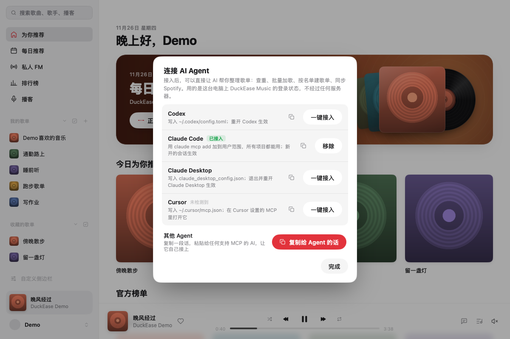</picture></p>

接好以后可以直接跟 agent 说「把这几个歌单里重复的歌删掉」「照这份歌名清单建一个歌单」。它能用的工具：

| 用途 | 工具 |
|---|---|
| 看 | `playlists` 列出歌单，`playlist` 读歌单里的歌（可按关键词筛），`search` 搜歌 |
| 找 | `match` 一次给最多 100 行「歌名 - 歌手」，每行返回最像的网易云歌曲和相似度；`duplicates` 找重复的歌 |
| 改 | `create_playlist`、`add_songs`、`remove_songs`、`rename_playlist`、`delete_playlist`、`like_songs` |
| Spotify | 读 Spotify 歌单和喜欢的歌曲、搜歌、加歌删歌、两边互相复制、同步关联的歌单、改正配错的歌，见下一节 |

只有自己建的歌单能改；收藏的别人的歌单只读，「我喜欢的音乐」不能改名也不能删。

**省 token**：回复是带表头的制表符分隔文本，一首歌一行，比同样内容的 JSON 短很多。长歌单可以分段读，导入一份清单调一次 `match` 就够，歌单链接和 Spotify 分享链接都能直接当 id 传。读过的歌单缓存一分钟。

**防风控**：app 和 MCP 两个进程共用同一份节奏记录。改歌单和搜歌的请求之间至少隔 400 毫秒；任何请求碰到 `-460`，之后一段时间改歌单和搜歌都暂停，再被拒就加倍等待，最长 15 分钟。网易云嫌搜得太快回 405 时，搜索会放慢一阵再继续。返回给 agent 的错误会写明还要等多久，让它别急着重试。

第一次调用时，钥匙串可能会问能不能让 DuckEase Music 读取登录信息，点「始终允许」。ad hoc 签名每次构建都会变，换新版本后可能再问一次。手动配置、完整工具列表和单次调用的上限见 [docs/MCP.md](docs/MCP.md)。

## Spotify 和网易云互通

连上 Spotify 后，侧边栏多一组「Spotify 歌单」，最上面是「Spotify 喜欢的歌曲」，显示哪些歌单可以自己挑。点开一个，里面的歌会在网易云上找到对应的那首，直接在 DuckEase Music 里放。Spotify 歌单在这里也能新建、改名、删除、加歌删歌。**Spotify 的音频不在这里播放**：Spotify 的接口不提供音频，能放的只有网易云（和打开了的备用音源）里有的歌，找不到的列在歌单页最底下。

<table>
  <tr>
    <td width="50%" valign="top"><b>Spotify 歌单页</b><br>匹配到的歌直接放，没找到的列在最底下；和网易云歌单关联后，这里能同步。<br><br><picture><source media="(prefers-color-scheme: dark)" srcset="assets/screenshots/spotify-dark.png">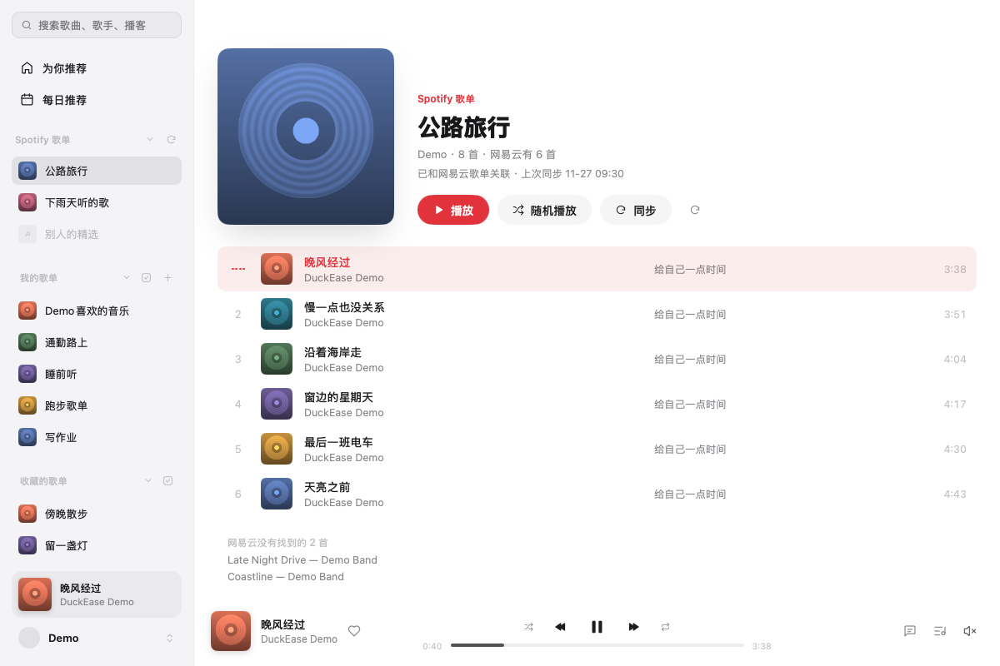</picture></td>
    <td width="50%" valign="top"><b>边游边匹配</b><br>小鸭游到哪，就匹配到哪。离开页面也接着找，侧边栏显示百分比。<br><br><picture><source media="(prefers-color-scheme: dark)" srcset="assets/screenshots/spotify-matching-dark.png">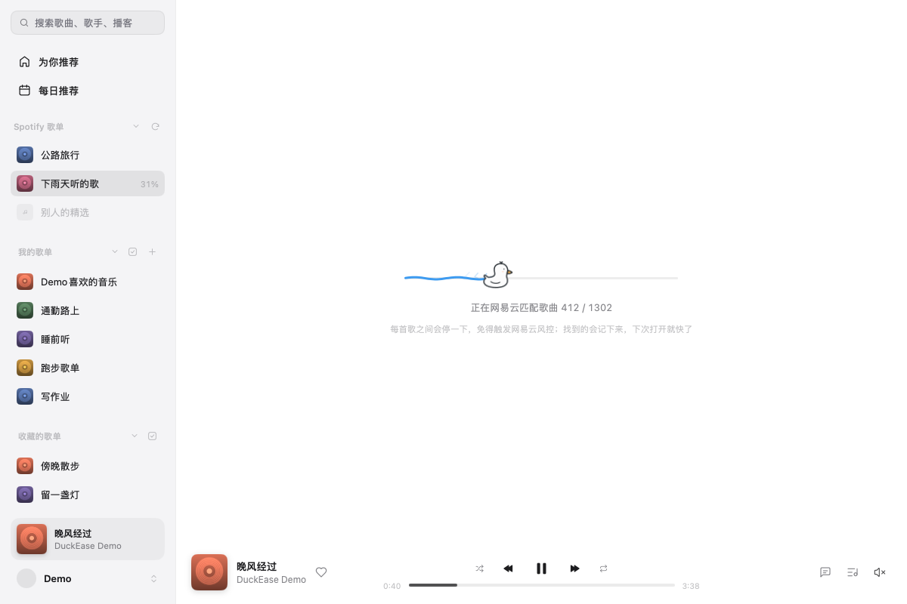</picture></td>
  </tr>
</table>

**连接**要用你自己的 Spotify 开发者 app：在 Spotify 的 Developer Dashboard 建一个，Redirect URI 填 `http://127.0.0.1:43821/callback`，把 Client ID 粘到「设置 → Spotify」，点「连接」。设置里有一步一步的指引。走 PKCE，不需要 Client Secret，令牌存在钥匙串里。按 Spotify 2026 年起的规定，app 的所有者要有 **Premium**，接口也只开放**自己创建或参与协作的歌单**；收藏的别人的歌单和官方歌单改从公开页面读，只能读到前 100 首。步骤和限制详见 [docs/SPOTIFY.md](docs/SPOTIFY.md)。

**匹配**按歌名、歌手和时长打分，会认网易云的歌手别名，歌名相同但歌手对不上的要时长也一样才算，免得把翻唱当原曲。打开歌单页不会自动去搜，直接显示上次读到的内容；点「更新」才重新读 Spotify、搜还没找过的歌，离开页面也会在后台接着找，侧边栏歌单名旁边显示百分比。找过的结果会记下来，以后只搜新加的歌。配错了，可以让 agent 用 `fix_match` 改过来。

**复制和同步**：Spotify 歌单页能「复制到网易云」，可以自己起名字（网易云不收某些名字时改一下就行），也可以直接关联一个已有的网易云歌单。自己的网易云歌单在「⋯」菜单里能「复制到 Spotify」，复制过的两个歌单会关联起来。之后的同步可以单向，也可以双向，但**只加不删**：一边删掉的歌，另一边不跟着删；你上次同步后删掉的歌，下次也不会被加回来。

## 看看界面

<picture>
  <source media="(prefers-color-scheme: dark)" srcset="assets/screenshots/home-dark.png">
  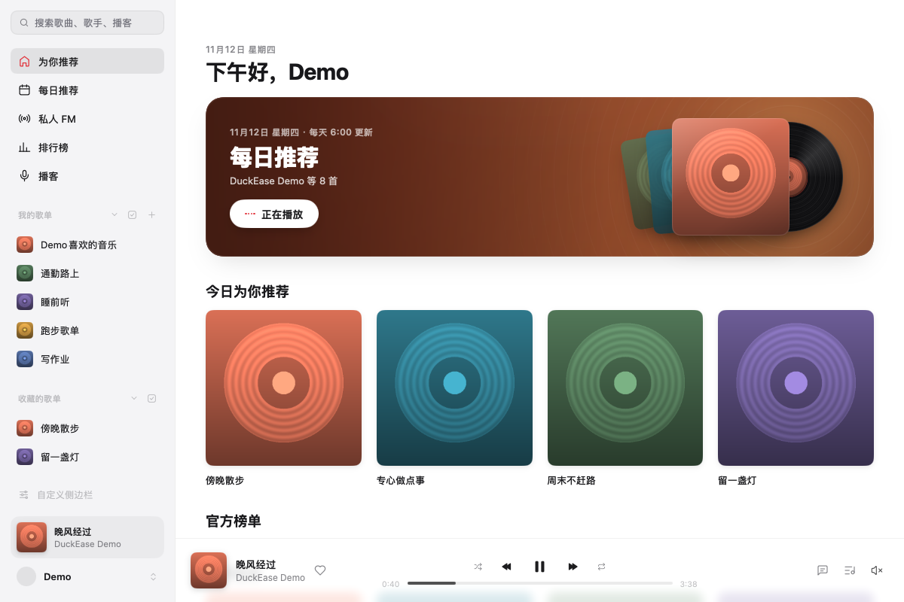
</picture>

截图由应用真实的 Go 界面离屏渲染，歌曲、歌词和封面都是本项目准备的演示内容，没有个人账号信息，也不代表在线曲库或实际播放已经验证。[截图复现方法](docs/SCREENSHOTS.md)。

### 播放页

<table>
  <tr>
    <td width="50%" valign="top"><b>正在播放</b><br>封面、控制和滚动歌词放在一页，歌词带翻译；封面能用鼠标倾斜、甩动切歌。歌从备用音源来时，进度条下面会标出「备用音源」和它给的音质。<br><br><picture><source media="(prefers-color-scheme: dark)" srcset="assets/screenshots/now-playing-dark.png">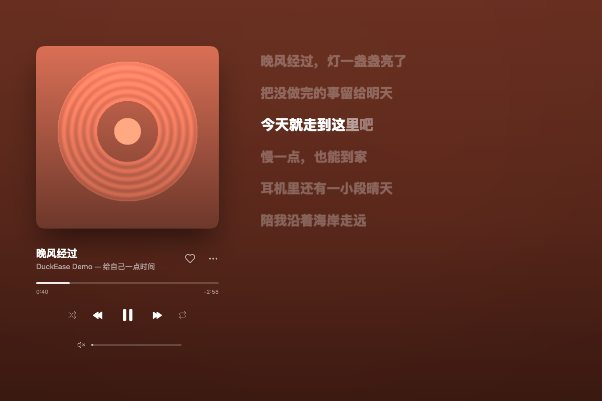</picture></td>
    <td width="50%" valign="top"><b>烟雾背景</b><br>实验功能：背景化成封面色调的烟雾，跟着低音起伏。在「设置 → 实验性功能」里打开。<br><br><picture><source media="(prefers-color-scheme: dark)" srcset="assets/screenshots/fog-dark.png">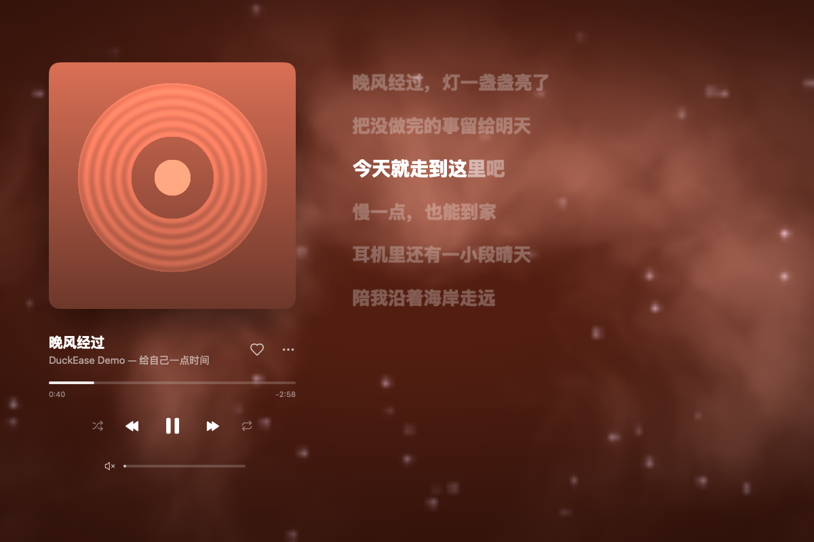</picture></td>
  </tr>
</table>

律动舞台把当前这句歌词单独放大，跟着逐字进度走，有三种效果可以切换：

<table>
  <tr>
    <td width="33%" valign="top"><b>流光</b><br>逐字点亮，一句一句往上走。<br><br><picture><source media="(prefers-color-scheme: dark)" srcset="assets/screenshots/stage-dark.png"></picture></td>
    <td width="33%" valign="top"><b>云阶</b><br>字一个个跳上台阶，唱到的字发光。<br><br><picture><source media="(prefers-color-scheme: dark)" srcset="assets/screenshots/stage-partita-dark.png"></picture></td>
    <td width="33%" valign="top"><b>倾诉</b><br>大字居中，安安静静地一句接一句。<br><br><picture><source media="(prefers-color-scheme: dark)" srcset="assets/screenshots/stage-tilt-dark.png"></picture></td>
  </tr>
</table>

<table>
  <tr>
    <td width="50%" valign="top"><b>选歌</b><br>待播清单铺成一排封面，拖着翻，点一张就放这首。<br><br><picture><source media="(prefers-color-scheme: dark)" srcset="assets/screenshots/wall-dark.png">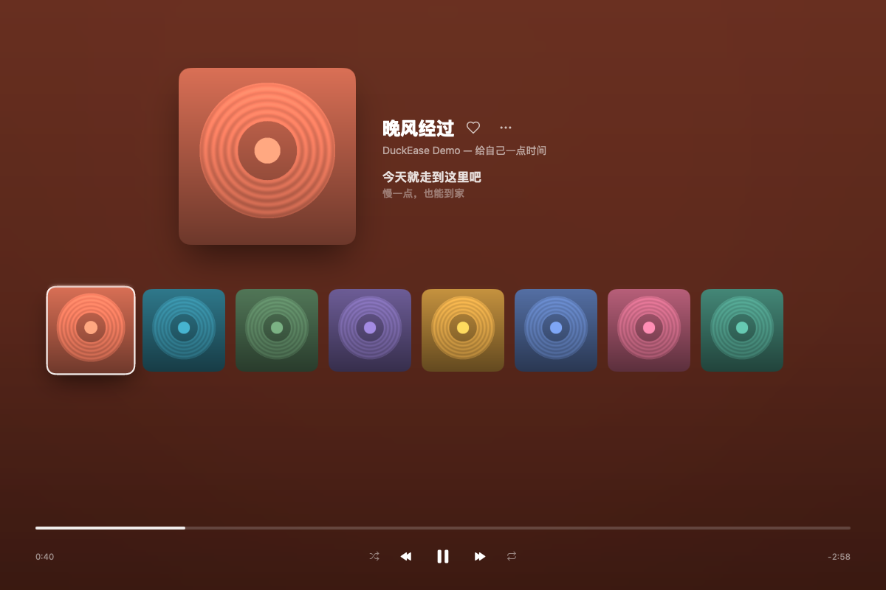</picture></td>
    <td width="50%" valign="top"><b>待播清单</b><br>看接下来要放什么，点一首就跳过去。<br><br><picture><source media="(prefers-color-scheme: dark)" srcset="assets/screenshots/queue-dark.png">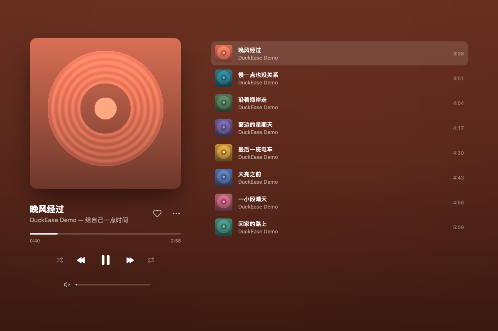</picture></td>
  </tr>
</table>

### 找歌与歌单

<table>
  <tr>
    <td width="50%" valign="top"><b>每日推荐</b><br>每天早上 6 点（北京时间）更新，窗口开着过夜也会换成新的一天。<br><br><picture><source media="(prefers-color-scheme: dark)" srcset="assets/screenshots/daily-dark.png">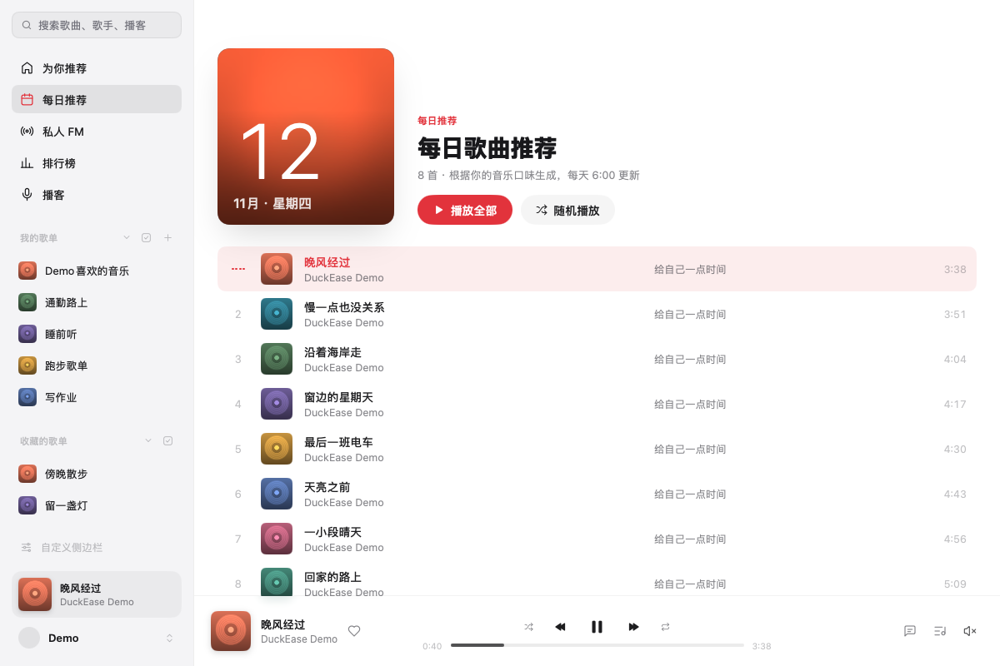</picture></td>
    <td width="50%" valign="top"><b>排序、搜索、试试手气</b><br>歌单可以按歌名、歌手、专辑、时长排序，中文按拼音排；「试试手气」每次打乱成新的顺序。歌单内搜索，找不到就一键搜全部。<br><br><picture><source media="(prefers-color-scheme: dark)" srcset="assets/screenshots/playlist-dark.png">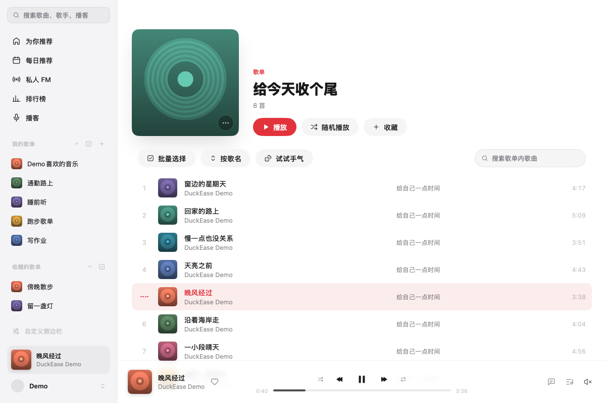</picture></td>
  </tr>
  <tr>
    <td width="50%" valign="top"><b>批量选择歌曲</b><br>点歌就是勾选，Shift 连选，⌘A 全选。底部浮条把选中的歌加到歌单、移到另一个歌单，或从歌单移除。「我喜欢的音乐」也能这样批量取消喜欢。<br><br><picture><source media="(prefers-color-scheme: dark)" srcset="assets/screenshots/picking-dark.png">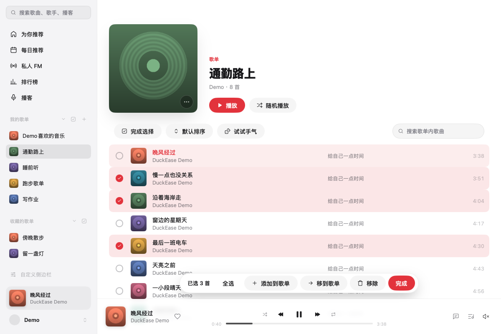</picture></td>
    <td width="50%" valign="top"><b>管理歌单</b><br>多选自己的歌单，复制或迁移到一个歌单，或一起删除；收藏的歌单可以复制成自己的、合并，或一起取消收藏。请求逐个发出，避开网易云的风控。<br><br><picture><source media="(prefers-color-scheme: dark)" srcset="assets/screenshots/manager-dark.png">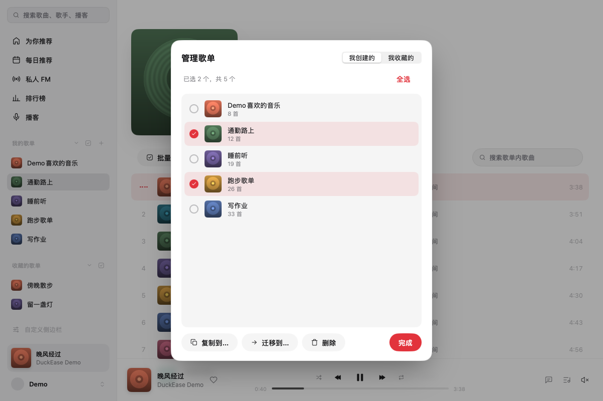</picture></td>
  </tr>
  <tr>
    <td width="50%" valign="top"><b>换封面</b><br>封面右下角的「⋯」里选「更换封面」，从歌单里歌曲的专辑封面中搜一张，或者用本机图片。封面只存在这台电脑上。<br><br><picture><source media="(prefers-color-scheme: dark)" srcset="assets/screenshots/cover-picker-dark.png">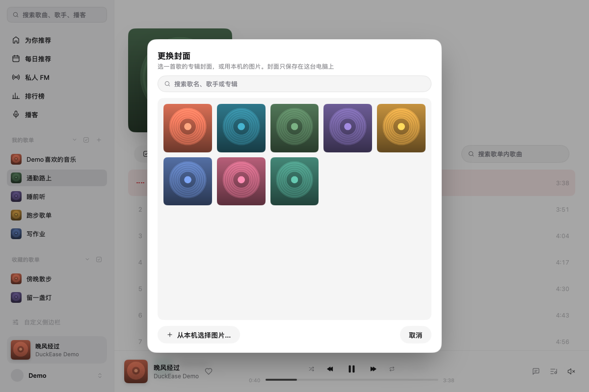</picture></td>
    <td width="50%" valign="top"><b>自定义侧边栏</b><br>每一项都能关掉，拖动或用箭头调顺序，底部的正在播放卡片也能隐藏。<br><br><picture><source media="(prefers-color-scheme: dark)" srcset="assets/screenshots/sidebar-dark.png">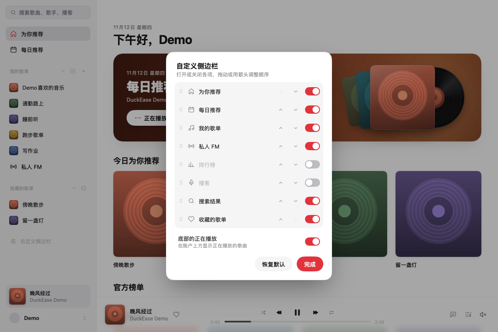</picture></td>
  </tr>
</table>

### 设置

<table>
  <tr>
    <td width="50%" valign="top"><b>备用音源与额度</b><br>默认关闭。打开后，网易云放不了的歌和灰色歌曲改从 GD音乐台 取，开关下面显示 5 分钟 40 次的额度用了多少。<br><br><picture><source media="(prefers-color-scheme: dark)" srcset="assets/screenshots/settings-dark.png">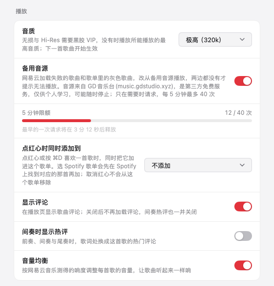</picture></td>
    <td width="50%" valign="top"><b>iCloud 备份</b><br>手动把设置、侧边栏布局、搜索记录和自定义封面存到 iCloud 云盘，换电脑后能恢复。不含网易云账号。<br><br><picture><source media="(prefers-color-scheme: dark)" srcset="assets/screenshots/backup-dark.png">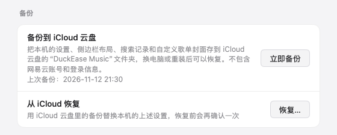</picture></td>
  </tr>
</table>

### 还有这些

- **间奏热评**：前奏、间奏和尾奏时，歌词的位置换成这首歌的热门评论。
- **心动模式和私人 FM**：从「我喜欢的音乐」开启心动模式，放完会接着推荐。
- **播客**：收听、订阅，节目也能点喜欢。
- **音量均衡**：按网易云测得的响度调整每首歌的音量。
- **预载下一首**：当前这首放满 10 秒，就提前下载下一首，切歌时几乎马上出声。
- **歌曲缓存**：听过的歌存在本机，再听不用等，上限可调；下次打开接着上次的进度。
- **进度条烟雾**：实验功能，进度条变成拖着烟雾的光点。
- **键盘**：空格播放暂停，⌘F 搜索，⌘[ ⌘] 前进后退，⌘D 喜欢，正在播放页 ⌘1–5 切换标签。
- **碰到风控会停**：收到 `-460` 时停下冷却 30 秒，不会一路跳过整张歌单。
- **检查更新**：只看本仓库的 Release，提示下载，不自动安装。

## 本机内存截图：191 MB

Go 原生界面，不套 WebView。下面是我自己 Mac 上的占用截图，**DuckEase Music：191 MB**。

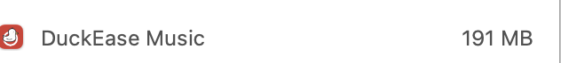

这是一次本机快照，不是固定内存上限或受控基准测试；实际占用会随播放、封面、缓存和打开的视图变化。

## 能做什么

| 听歌 | 找内容 | 桌面体验 |
|---|---|---|
| 待播清单、随机、循环、喜欢 | 每日推荐、歌单、排行榜 | 浅色、深色、跟随系统 |
| 标准到 Hi-Res，取决于实际权限 | 搜索歌曲、歌手、专辑、用户、播客 | 本地歌曲缓存、恢复上次进度、预载下一首 |
| 同步歌词、翻译 | 私人 FM、心动模式 | 封面手势、键盘操作 |
| 收听和订阅播客 | 歌手页、专辑页、用户页 | 可自定义的侧边栏 |
| 批量选歌、移动、移除 | 歌单管理、复制收藏的歌单 | 自定义歌单封面、iCloud 备份 |
| Spotify 歌单经网易云匹配播放 | Spotify 与网易云歌单互相复制、同步 | 自带 MCP 服务器，可接 AI agent |

功能可用性由平台决定。选了某种音质，不等于获得了对应播放权限。本项目不增加会员解锁功能，也不承诺绕过访问限制。唯一的例外默认关闭、需要自己打开：设置里的「备用音源」会在歌曲加载失败或显示为灰色时，向第三方的 [GD音乐台](https://music.gdstudio.xyz) 接口取播放地址。它是别人运营的免费服务，仅限个人学习使用，可能随时停止。

## 和原版有什么不同

- 改名为 **DuckEase Music**，换了小鸭图标，保留旧版本地数据目录的迁移。
- 新增 MCP 服务器和「连接 AI Agent…」，agent 可以读写自己的网易云歌单；新增 Spotify 歌单的匹配播放、复制和同步。
- 播放更顺：提前下载下一首，失败时有限次数重试并记录诊断日志；收到风控代码 `-460` 时停下冷却，不会连续跳过整张歌单。
- 歌单好管了：排序与搜索、批量选择歌曲、歌单管理、自定义封面。
- 还有自定义侧边栏、可选的备用音源、评论开关和 iCloud 备份；删除了刘海播放器。
- 去掉了依赖原作者 Release 的自动更新，改为检查本仓库的 Release，只提示下载。
- 去掉了因语音库下载失效而无法使用的本地播客字幕；播客仍能收听。
- 公开版移除了继承的旧官网、网站歌曲演示和原作者的签名发布工作流。

具体来源与修改日期见 [NOTICE.md](NOTICE.md)，每个版本的更新内容见 [Release](https://github.com/yuanruoyu515/duckease-music/releases) 和[更新日志](CHANGELOG.md)，技术细节见[维护说明](MAINTENANCE.md)。公开仓库从清理后的源码快照开始，较早的本地开发历史不随之上传。

## macOS 安装

[**下载最新的 macOS DMG 安装包**](https://github.com/yuanruoyu515/duckease-music/releases/latest)：在 Release 页面下载 `.dmg`，同页有更新内容和校验值。

1. 下载并打开 DMG。
2. 把 **DuckEase Music** 拖进旁边的 **Applications（应用程序）**。
3. 推出磁盘映像，再从「应用程序」打开 DuckEase Music。

需要 macOS **13+**。通用版包含 Apple Silicon 和 Intel 两种架构；本地构建与打包检查在 Apple Silicon 上完成，未验证 Intel 实机运行。本版本为 **ad hoc 签名，未经 Apple 公证**。如果被系统拦截，先核对下载来源和校验值，再按 [Apple 的说明](https://support.apple.com/zh-cn/102445)在「隐私与安全性」里批准打开，不要关闭系统整体安全保护。

应用启动后和每天会检查一次本仓库的 Release，有新版本时提示下载 DMG，也可以稍后提醒或忽略这个版本。它不会自己安装任何东西，可以在「设置 → 更新」里关掉。每个版本的源码随 Release 标签提供，应用包内也附有许可证和源码获取说明。

## 自己构建

| 需要 | 说明 |
|---|---|
| Go **1.27.4 或更新版本** | 以 `go.mod` 为准 |
| macOS **13+** | 本分支已在 Apple Silicon 上验证本地构建 |
| Xcode | 打包图标需要其中的 `actool`，只有 Command Line Tools 不够 |
| 网络 | 用于拉取依赖、访问平台服务 |

```bash
git clone https://github.com/yuanruoyu515/duckease-music.git
cd duckease-music

# 开发模式运行原生应用
go tool mygo dev

# 先测试，再生成 ad hoc 签名的 macOS 应用和磁盘映像
./scripts/build-local.sh
```

Apple Silicon 产物在 `build/darwin-arm64/`，包含 `DuckEase Music.app` 和 `.dmg`。要构建通用 Mac 版本，运行 `./scripts/build-local.sh -platform darwin/universal`；本分支尚未验证 Intel 实机运行，继承的 Windows、Linux 构建路径也未验证。

本地构建仅使用 **ad hoc 签名，未经 Apple 公证**，不使用原作者的 Developer ID。下载的构建可能需要在「隐私与安全性」里批准打开；不要关闭系统整体安全保护。

> [!NOTE]
> **从原版迁移：先退出旧应用。** 为兼容已有登录信息，暂时保留旧 bundle identifier，因此新旧版本不能独立同时运行。首次启动可能把旧版设置和缓存移到 DuckEase 目录，需要保留两份时先备份。签名变化可能触发钥匙串授权，或需要重新扫码登录。

## 登录之前

- 这是第三方客户端，请自行评估账号使用风险。登录、播放和内容可用性都可能随时变化或停止。
- 打包版通过系统凭据存储保存登录态；开发版把 session 文件保存在本机。两者都不能贴进 issue 或提交到 Git。
- 应用会请求网易云服务及媒体主机；连了 Spotify 才会请求 Spotify。代码中没有维护者运营的音乐代理或账号服务，维护者也无法控制平台如何处理数据。
- 接上 MCP 的 agent 用的是你的网易云登录，能改、能删你自己的歌单。让它动手前，先确认它要做什么。
- 缓存、设置、播放状态、歌曲匹配记录和诊断日志保存在设备上。日志可能带歌曲 ID 和错误细节，分享前先检查、脱敏。

账号、内容和维护边界的完整说明见[隐私说明](PRIVACY.md)和[免责声明](DISCLAIMER.md)。

## 反馈与贡献

这是业余个人维护，没有固定更新周期或回复时限。欢迎范围清楚、能复现的小修复，提交前请读[贡献说明](CONTRIBUTING.md)和[测试规范](AGENTS.md)。

播放出错时，请附系统、提交版本、操作步骤和脱敏后的错误。遇到 `-460` 先等待，不要加大重试频率。请勿提交会员解锁、绕过地区限制、批量抓取或分享账号凭据的需求。

权利人可提交[权利反馈](https://github.com/yuanruoyu515/duckease-music/issues/new?template=rights.yml)，写明具体内容和希望采取的措施；不要公开上传身份证明或私人函件。也可使用 GitHub 的[版权处理流程](https://docs.github.com/en/site-policy/content-removal-policies/guide-to-submitting-a-dmca-takedown-notice)。

## 致谢与许可

- **[egoist](https://github.com/egoist) 及原项目贡献者**：MyGo Music 的原始开发与本分支的基础。
- **[LeslieYon/mygo-cloudmusic](https://github.com/LeslieYon/mygo-cloudmusic)**：本项目采用的源码保留镜像，基点 `3c0eb71`。
- **[MyGo](https://github.com/egoist/mygo)**：原生应用与 UI 框架。
- **[NeteaseCloudMusicApi](https://github.com/Binaryify/NeteaseCloudMusicApi)**：加密和登录流程参考。
- **[folia-major](https://github.com/chthollyphile/folia-major)**：歌词动画参考。
- **[GD音乐台(music.gdstudio.xyz)](https://music.gdstudio.xyz)**：可选的备用音源，由 GD Studio 提供，按站方要求注明出处。

源码继续采用 **[AGPL-3.0](LICENSE)**。请保留原作者署名与许可声明，并按许可证履行再分发、修改后网络部署等情形下适用的义务。软件许可不授予音乐、歌词、封面或第三方商标的权利，详见 [NOTICE.md](NOTICE.md)。

个人维护：**Ruoyu / SysNomad** · [GitHub](https://github.com/yuanruoyu515) · [Threads @realtimyry](https://www.threads.com/@realtimyry)
