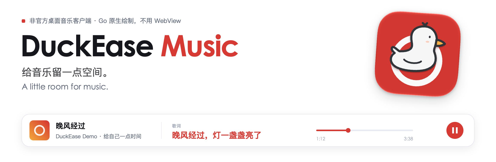
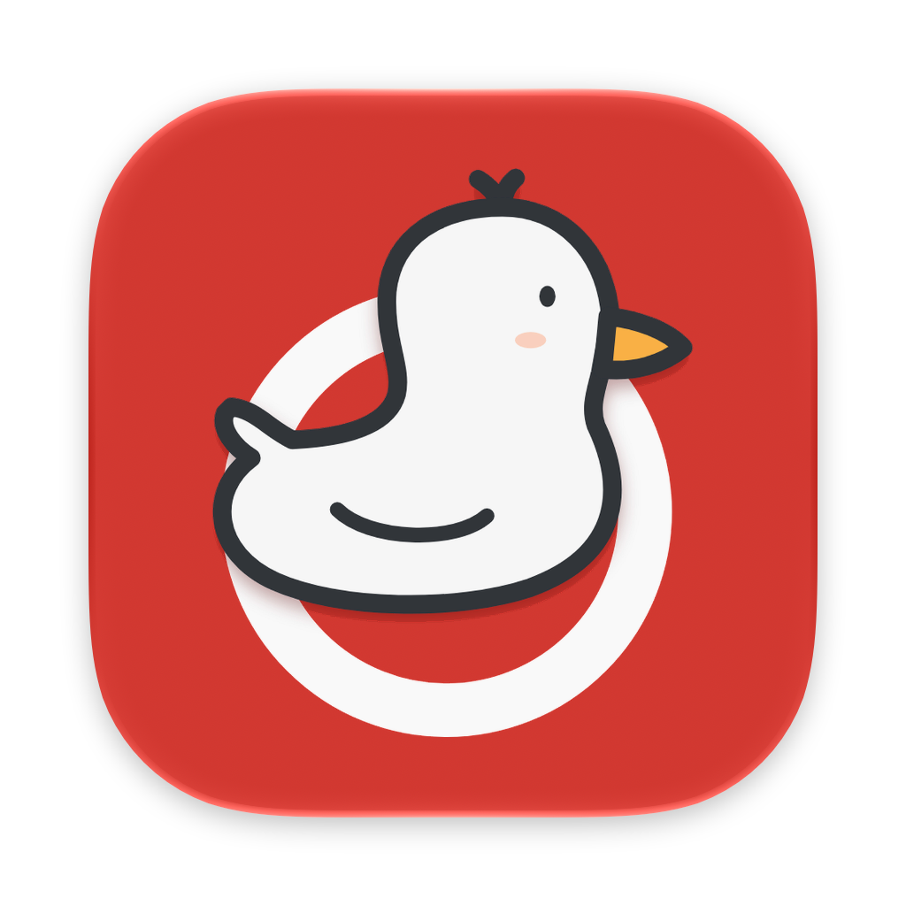
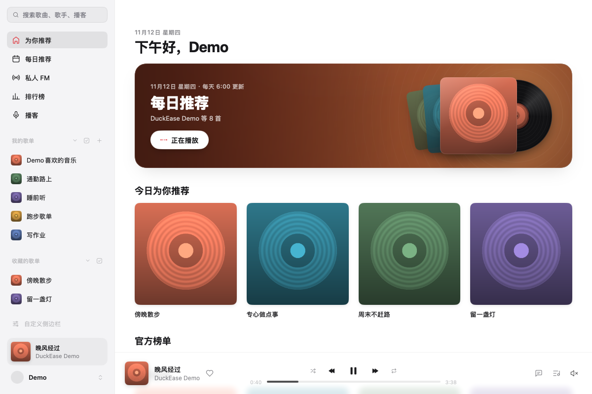
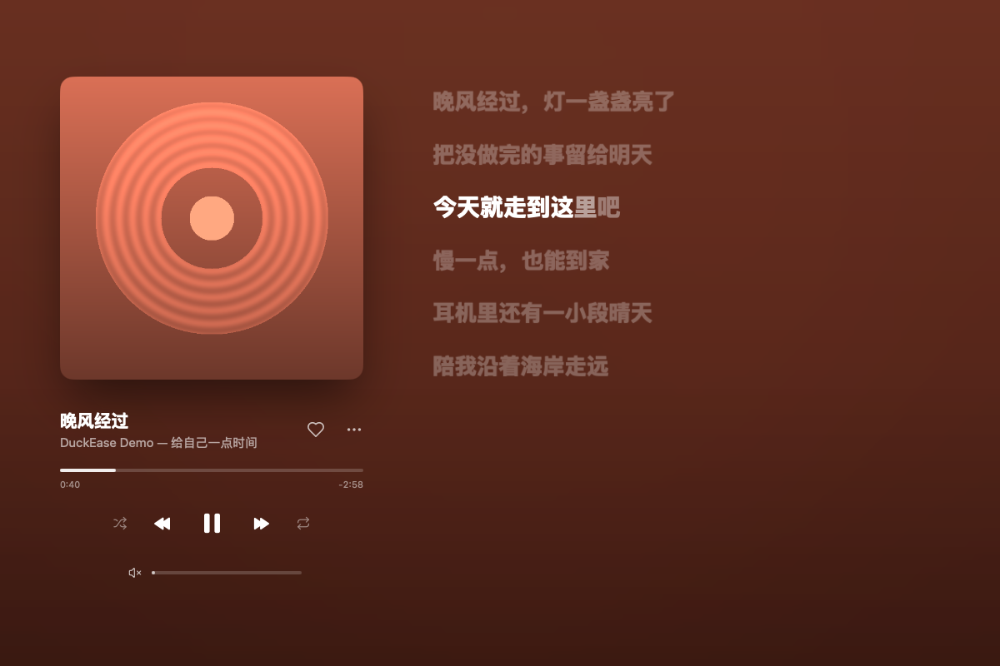
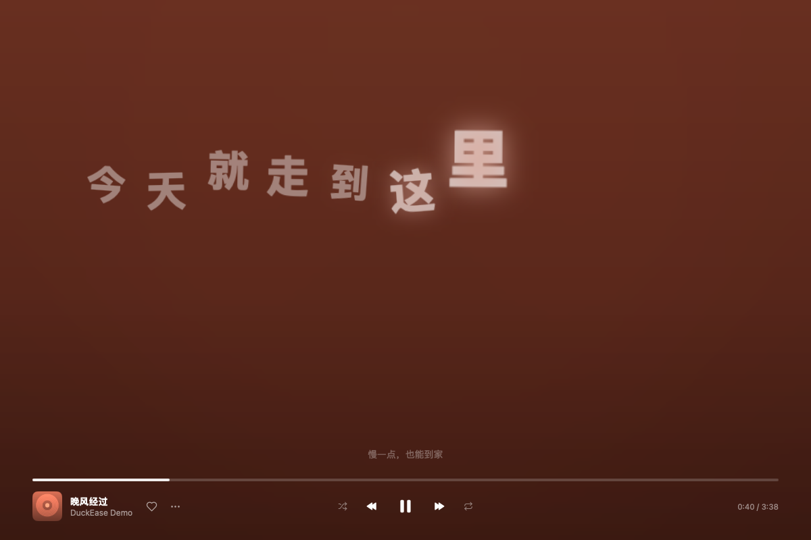
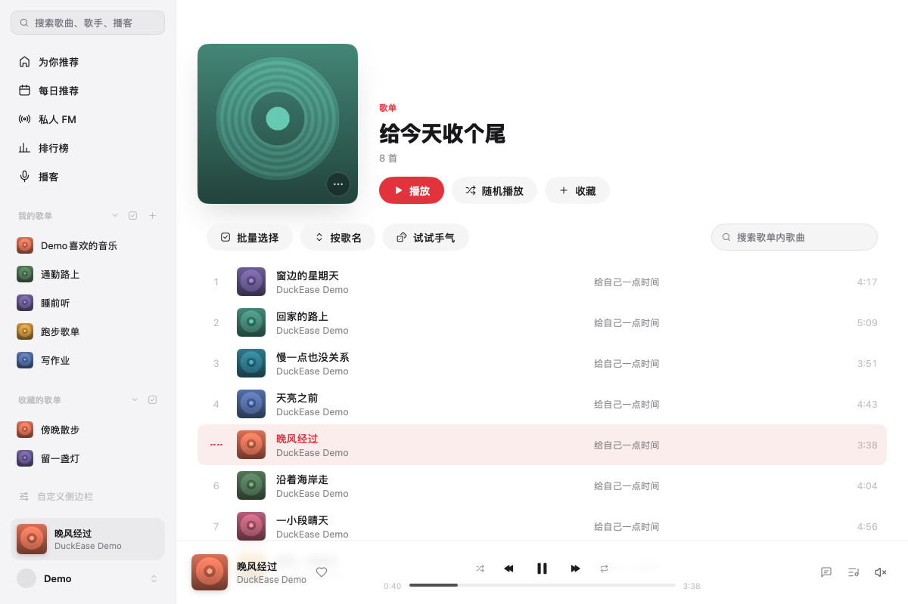
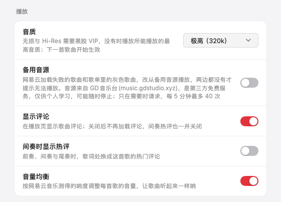
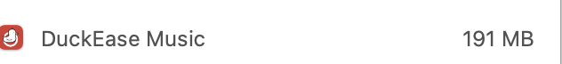

<picture>
  <source media="(prefers-color-scheme: dark)" srcset="assets/brand/banner-zh-Hans-dark.png">
  
</picture>

<p>
  <a href="https://github.com/yuanruoyu515/duckease-music/releases/latest"></a>
  
  
  
  <a href="LICENSE"></a>
  <a href="https://www.threads.com/@realtimyry"></a>
</p>

[English](README.md) · **简体中文** · [免责声明](DISCLAIMER.md) · [隐私说明](PRIVACY.md)



[MyGo Music（MyGo 云音乐）](https://github.com/egoist/mygo-cloudmusic)下线了。我还想继续用，就保留了一份源码，接着修自己碰到的问题。这个仓库是它的个人接续维护版，现在叫 **DuckEase Music**。

原应用和大部分代码由 **egoist 及原项目贡献者**完成。我通过 [LeslieYon 保留的镜像](https://github.com/LeslieYon/mygo-cloudmusic)取得源码，在此基础上维护衍生版本。这里的「接续维护」是我自己的行为，不代表原作者正式移交、授权代理或背书。

> [!IMPORTANT]
> **非官方客户端，业余维护。** 与网易、网易云音乐及原作者没有隶属、合作或代言关系。能否播放仍取决于账号、会员、地区和平台返回结果。登录前请读[免责声明](DISCLAIMER.md)；声明不能授予音乐版权，也不能免除法定义务。

<table>
  <tr>
    <td width="33%" valign="top"> <b>Go 原生界面</b><br>由 MyGo 直接绘制，桌面应用不用 WebView。</td>
    <td width="33%" valign="top"> <b>留点空间给歌词</b><br>完整播放页、歌词翻译，还有几种律动效果。</td>
    <td width="33%" valign="top"> <b>自己用，接着修</b><br>换个名字、放只小鸭，维护我在用的这个版本。</td>
  </tr>
</table>

## 看看界面

<picture>
  <source media="(prefers-color-scheme: dark)" srcset="assets/screenshots/home-dark.png">
  
</picture>

截图由应用真实的 Go 界面渲染，歌曲、歌词和封面均为本项目准备的演示内容，没有个人账号信息，也不代表在线曲库或实际播放已经通过验证。[截图复现方法](docs/SCREENSHOTS.md)。

<table>
  <tr>
    <td width="50%" valign="top"><b>正在播放</b><br>封面、播放控制和滚动歌词放在一页。<br><br><picture><source media="(prefers-color-scheme: dark)" srcset="assets/screenshots/now-playing-dark.png"></picture></td>
    <td width="50%" valign="top"><b>歌词律动</b><br>切到单独的舞台，看歌词跟着播放进度变化。<br><br><picture><source media="(prefers-color-scheme: dark)" srcset="assets/screenshots/stage-dark.png"></picture></td>
  </tr>
</table>

## 0.1.25-duckease.3 新功能

<table>
  <tr>
    <td width="58%" valign="top"><b>歌单排序与搜索</b><br>可以按歌名、歌手、专辑、时长排序，也可以倒序，中文按拼音排。<b>试试手气</b>每点一次就打乱成新的顺序，播放按页面上的顺序走。搜索框按歌名、歌手、专辑筛选，歌单里没有的歌，点一下就能到全部歌曲里搜。<br><br><picture><source media="(prefers-color-scheme: dark)" srcset="assets/screenshots/playlist-dark.png"></picture></td>
    <td width="42%" valign="top"><b>备用音源与评论开关</b><br>都在「设置 → 播放」里。<b>备用音源</b>默认关闭，打开后，网易云加载失败的歌和歌单里的灰色歌曲改从 <a href="https://music.gdstudio.xyz">GD音乐台(music.gdstudio.xyz)</a> 取，两边都没有才提示无法播放。<b>显示评论</b>控制播放页的评论和间奏热评。<br><br><picture><source media="(prefers-color-scheme: dark)" srcset="assets/screenshots/settings-dark.png"></picture></td>
  </tr>
</table>

另外，应用会检查本仓库的新版本并提示下载，「关于」窗口里有我的 GitHub 和 Threads 链接。

## 尚未发布的新功能

- **批量管理歌单**：歌单页点「批量选择」，勾选的歌可以加到、移到别的歌单，或从当前歌单移除。侧边栏「我的歌单」「收藏的歌单」旁的按钮打开管理窗口，可以批量删除、取消收藏、复制或合并歌单。
- **自定义封面**：点自己歌单的封面就能换图，图片只存在本机。
- **自定义侧边栏**：每一项都能关掉或调整顺序。
- **备用音源提示**：播放页标出来自备用音源的歌和它的音质；设置里能看到 5 分钟限额用了多少。
- **iCloud 备份**：在「设置 → 备份」里手动备份和恢复本机设置，不含网易云账号。
- 刘海播放器已删除。

## 本机内存截图：191 MB

Go 原生界面，不套 WebView。下面是我自己 Mac 上的占用截图，**DuckEase Music：191 MB**。



这是一次本机快照，不是固定内存上限或受控基准测试；实际占用会随播放、封面、缓存和打开的视图变化。

## 能做什么

| 听歌 | 找内容 | 桌面体验 |
|---|---|---|
| 待播清单、随机、循环、喜欢 | 每日推荐、歌单、排行榜 | 浅色、深色、跟随系统 |
| 标准到 Hi-Res，取决于实际权限 | 搜索歌曲、歌手、专辑、用户、播客 | 本地歌曲缓存、恢复上次进度 |
| 同步歌词、翻译 | 私人 FM、心动模式 | 封面手势、键盘操作 |
| 收听和订阅播客 | 歌手页、专辑页、用户页 | 可自定义的侧边栏 |

功能可用性由平台决定。选了某种音质，不等于获得了对应播放权限。本项目不增加会员解锁功能，也不承诺绕过访问限制。唯一的例外默认关闭、需要自己打开：设置里的「备用音源」会在歌曲加载失败或显示为灰色时，向第三方的 [GD音乐台](https://music.gdstudio.xyz) 接口取播放地址。它是别人运营的免费服务，仅限个人学习使用，可能随时停止。

## 和原版有什么不同

- 改名为 **DuckEase Music**，换了小鸭图标，保留旧版本地数据目录的迁移。
- 去掉了依赖原作者 Release 的自动更新，改为检查本仓库的 Release，只提示下载。
- 去掉了因语音库下载失效而无法使用的本地播客字幕；播客仍能收听。
- 播放失败时有限次数重试并记录诊断日志；收到风控代码 `-460` 时停下冷却，避免连续跳过整张歌单。
- 公开版移除了继承的旧官网、网站歌曲演示和原作者的签名发布工作流。
- 新增歌单排序、试试手气、歌单内搜索，可选的备用音源，以及评论开关。

具体来源与修改日期见 [NOTICE.md](NOTICE.md)，改动见[更新日志](CHANGELOG.md)，技术细节见[维护说明](MAINTENANCE.md)。公开仓库从清理后的源码快照开始，较早的本地开发历史不随之上传。

## macOS 安装

[**下载 macOS DMG 安装包**](https://github.com/yuanruoyu515/duckease-music/releases/download/v0.1.25-duckease.3/duckease-music-0.1.25-duckease.3.dmg) · [发布说明与校验值](https://github.com/yuanruoyu515/duckease-music/releases/tag/v0.1.25-duckease.3)

1. 下载并打开 DMG。
2. 把 **DuckEase Music** 拖进旁边的 **Applications（应用程序）**。
3. 推出磁盘映像，再从「应用程序」打开 DuckEase Music。

需要 macOS **13+**。通用版包含 Apple Silicon 和 Intel 两种架构；本地构建与打包检查在 Apple Silicon 上完成，未验证 Intel 实机运行。本版本为 **ad hoc 签名，未经 Apple 公证**。如果被系统拦截，先核对下载来源和校验值，再按 [Apple 的说明](https://support.apple.com/zh-cn/102445)批准打开，不要关闭系统整体安全保护。

应用启动后和每天会检查一次本仓库的 Release，有新版本时提示下载 DMG，也可以稍后提醒或忽略这个版本。它不会自己安装任何东西，可以在「设置 → 更新」里关掉。每个版本的源码随 Release 标签提供，应用包内也附有许可证和源码获取说明。

## 自己构建

| 需要 | 说明 |
|---|---|
| Go **1.27.3 或更新版本** | 以 `go.mod` 为准 |
| macOS **13+** | 本分支已在 Apple Silicon 上验证本地构建 |
| Xcode | 打包图标需要其中的 `actool`，只有 Command Line Tools 不够 |
| 网络 | 用于拉取依赖、访问平台服务 |

```bash
git clone https://github.com/yuanruoyu515/duckease-music.git
cd duckease-music

# 开发模式运行原生应用
go tool mygo dev

# 先测试，再生成 ad hoc 签名的 macOS 应用和磁盘映像
./scripts/build-local.sh
```

Apple Silicon 产物在 `build/darwin-arm64/`，包含 `DuckEase Music.app` 和 `.dmg`。要构建通用 Mac 版本，运行 `./scripts/build-local.sh -platform darwin/universal`；本分支尚未验证 Intel 实机运行，继承的 Windows、Linux 构建路径也未验证。

本地构建仅使用 **ad hoc 签名，未经 Apple 公证**，不使用原作者的 Developer ID。下载的构建可能需要在「隐私与安全性」里批准打开；不要关闭系统整体安全保护。

> [!NOTE]
> **从原版迁移：先退出旧应用。** 为兼容已有登录信息，暂时保留旧 bundle identifier，因此新旧版本不能独立同时运行。首次启动可能把旧版设置和缓存移到 DuckEase 目录，需要保留两份时先备份。签名变化可能触发钥匙串授权，或需要重新扫码登录。

## 登录之前

- 这是第三方客户端，请自行评估账号使用风险。登录、播放和内容可用性都可能随时变化或停止。
- 打包版通过系统凭据存储保存登录态；开发版把 session 文件保存在本机。两者都不能贴进 issue 或提交到 Git。
- 应用会请求网易云服务及媒体主机。代码中没有维护者运营的音乐代理或账号服务，维护者也无法控制平台如何处理数据。
- 缓存、设置、播放状态和诊断日志保存在设备上。日志可能带歌曲 ID 和错误细节，分享前先检查、脱敏。

账号、内容和维护边界的完整说明见[隐私说明](PRIVACY.md)和[免责声明](DISCLAIMER.md)。

## 反馈与贡献

这是业余个人维护，没有固定更新周期或回复时限。欢迎范围清楚、能复现的小修复，提交前请读[贡献说明](CONTRIBUTING.md)和[测试规范](AGENTS.md)。

播放出错时，请附系统、提交版本、操作步骤和脱敏后的错误。遇到 `-460` 先等待，不要加大重试频率。请勿提交会员解锁、绕过地区限制、批量抓取或分享账号凭据的需求。

权利人可提交[权利反馈](https://github.com/yuanruoyu515/duckease-music/issues/new?template=rights.yml)，写明具体内容和希望采取的措施；不要公开上传身份证明或私人函件。也可使用 GitHub 的[版权处理流程](https://docs.github.com/en/site-policy/content-removal-policies/guide-to-submitting-a-dmca-takedown-notice)。

## 致谢与许可

- **[egoist](https://github.com/egoist) 及原项目贡献者**：MyGo Music 的原始开发与本分支的基础。
- **[LeslieYon/mygo-cloudmusic](https://github.com/LeslieYon/mygo-cloudmusic)**：本项目采用的源码保留镜像，基点 `3c0eb71`。
- **[MyGo](https://github.com/egoist/mygo)**：原生应用与 UI 框架。
- **[NeteaseCloudMusicApi](https://github.com/Binaryify/NeteaseCloudMusicApi)**：加密和登录流程参考。
- **[folia-major](https://github.com/chthollyphile/folia-major)**：歌词动画参考。
- **[GD音乐台(music.gdstudio.xyz)](https://music.gdstudio.xyz)**：可选的备用音源，由 GD Studio 提供，按站方要求注明出处。

源码继续采用 **[AGPL-3.0](LICENSE)**。请保留原作者署名与许可声明，并按许可证履行再分发、修改后网络部署等情形下适用的义务。软件许可不授予音乐、歌词、封面或第三方商标的权利，详见 [NOTICE.md](NOTICE.md)。

个人维护：**Ruoyu / SysNomad** · [GitHub](https://github.com/yuanruoyu515) · [Threads @realtimyry](https://www.threads.com/@realtimyry)
